# Warmteverlies Tekentafel

Teken de plattegrond van je woning en zie direct het warmteverlies per ruimte. Daarnaast rekent de app de afgifte van radiatoren en vloerverwarming door en laat zien welke warmtepomp past.

**[Open de app →](https://mellotronscratch.github.io/warmteverlies-tekentafel/)**

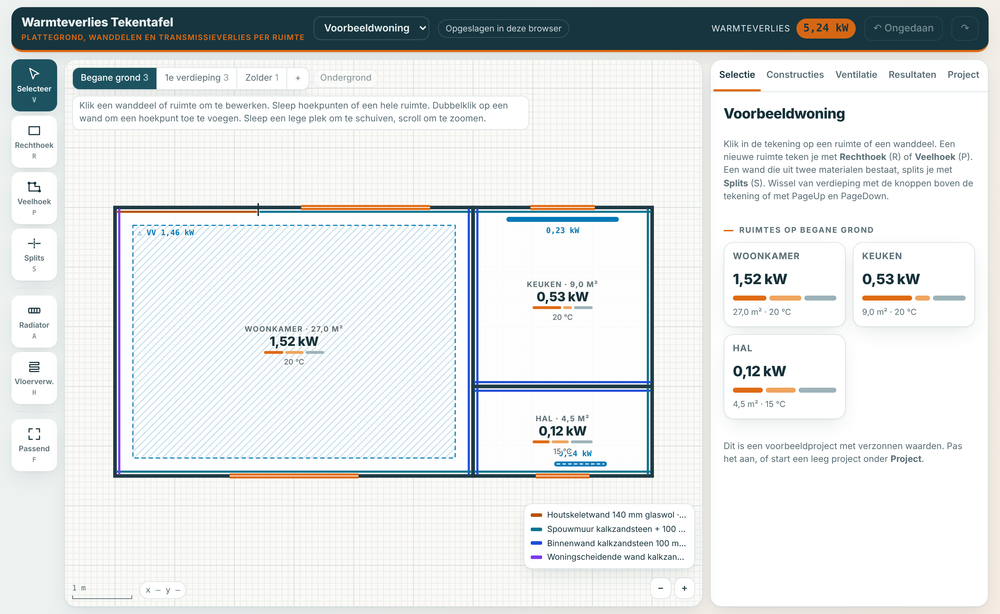

## Wat het doet

- **Tekenen**: ruimtes als rechthoek of veelhoek, binnenwanden trekken die een ruimte in tweeën delen, meerdere verdiepingen met een andere verdieping als lichtgrijze ondergrond, trappenhuizen en vides die doorlopen.
- **Wanddelen**: splits een wand in delen met elk een eigen constructie. De app herkent aan welke ruimte een wand grenst. Een wand tussen twee ruimtes heeft aan beide kanten dezelfde constructie en deuren.
- **2,5D-weergave**: bekijk de verdiepingen gestapeld en van opzij. Klik een vloer of wand aan om hem te bewerken.
- **Warmtebeeld**: kleur elk vlak van groen tot rood naar zijn warmteverlies per m².
- **Constructies**: opbouw in lagen (R = d / λ) met luchtspouwen, geventileerde spouwen en stijlen of regels volgens NEN-EN-ISO 6946, of direct een U-waarde.
- **Schuine daken**: zadeldak en lessenaarsdak met muurplaathoogte en vlak plafond (hanenbalk), inclusief juiste wand- en dakoppervlakken en inhoud.
- **Ventilatie en infiltratie**: systeem A, C of D met WTW, overstroom tussen ruimtes en infiltratie uit qv10.
- **Afgifte**: radiatoren (vermogen zelf invullen of afleiden uit type, hoogte en lengte), convectoren, fancoils (met boosters) en vloerverwarming bij je eigen aanvoer- en retourtemperatuur. Met controle van de aansluitleiding (de getekende leiding naar het element) en de minimaal nodige aanvoertemperatuur.
- **Verbeteradviezen** en **warmtepompkeuze**: vergelijk warmtepompen met het warmteverlies bij −10 °C (dekt het maximale vermogen het verlies?) en bij +10 °C (kan hij ver genoeg terugregelen, of gaat hij pendelen?). Per warmtepomp zie je vanaf welke buitentemperatuur hij pendelt. De lijst is gesorteerd op beide.
- **Export**: JSON, CSV en [heatlossjs](https://github.com/trystanLea/heatlossjs).

## Gebruik

Gebruik de link hierboven, of draai de app op je eigen computer. Installeren hoeft niet, maar je hebt wel een eenvoudige webserver nodig. De app laadt zijn gegevens uit de map `data/`, en browsers laden zulke bestanden niet als je `index.html` direct opent. Bijvoorbeeld:

```sh
cd warmteverlies-tekentafel
python3 -m http.server
```

Open daarna http://localhost:8000. In VS Code kan het ook met de extensie *Live Server*.

De kolom rechts met de eigenschappen maak je breder of smaller door de rand aan de linkerkant te verslepen. Dubbelklik op die rand zet hem terug op de standaardbreedte. Je browser onthoudt de breedte.

Met **Lagen** boven de tekening zet je leidingen en warmtepomp, radiatoren en vloerverwarming, luchtstromen, trappen en de onderlegger aan of uit. Zo werk je rustiger aan de ruimtes en wanden. Kies je een gereedschap voor iets wat uit staat, zoals *Leiding*, dan komt die laag vanzelf terug.

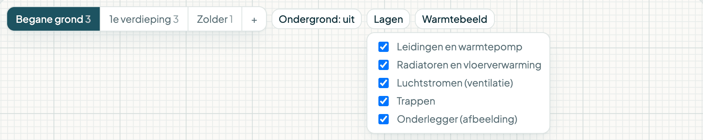

Met **Ondergrond** kies je welke verdieping lichtgrijs onder de tekening staat, met de omtrek van de ruimtes en de leidingen. Standaard is dat de verdieping eronder, maar je kunt ook een andere kiezen, bijvoorbeeld de zolder terwijl je de 1e verdieping tekent. Je kunt ook de kruipruimte kiezen. De keuze geldt per verdieping en je browser onthoudt hem. Toets `O` zet de ondergrond aan of uit. Op de lijnen van de ondergrond kun je snappen.

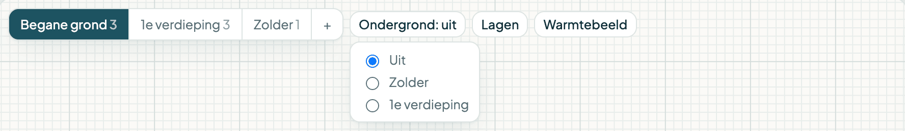

Staat iets op de verkeerde verdieping, zoals een leiding, een ruimte of de warmtepomp, kies dan in het paneel bij **Verdieping** de juiste. Radiatoren en vloerverwarming gaan met hun ruimte mee. De warmtepomp kun je ook aanklikken en verslepen.

Met **Rapport (PDF)** bovenaan *Resultaten* maak je een rapport van het hele project. Het bevat de uitgangspunten, de plattegronden per verdieping, het warmteverlies per ruimte met de berekening, de constructies met hun laagopbouw, de afgifte en de stooklijn, het leidingnet met schema en inregeladvies, de verbeteradviezen en de warmtepomp. Bij de warmtepomp staan de gekozen warmtepomp en de geschikte alternatieven, zodat je daar later nog uit kunt kiezen. Kies **Afdrukken of bewaren als PDF** en daarna in het printvenster *Opslaan als PDF*.

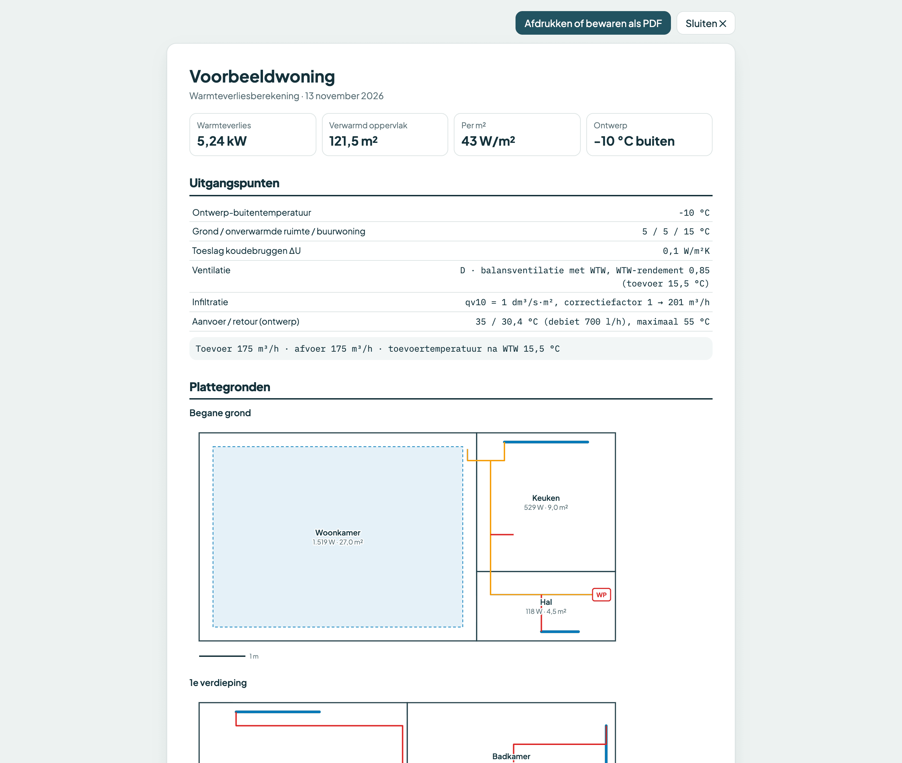

Projecten worden in je browser opgeslagen (localStorage). Exporteer regelmatig een `.json` als reservekopie, want bij het wissen van browsergegevens ben je ze kwijt.

## Onderlegger: een bouwtekening overtekenen

Onder **Project → Onderlegger** leg je een afbeelding (jpg, png of webp) onder de verdieping die je open hebt, bijvoorbeeld een scan of foto van de bouwtekening. Een pdf sla je eerst op als afbeelding of je maakt er een schermafbeelding van.

1. Kies **Afbeelding kiezen**, sleep een afbeelding op de tekening of plak er een met Ctrl/Cmd+V (bijvoorbeeld een schermafbeelding van een pdf). De app verkleint de afbeelding en legt hem in beeld. Een nieuwe afbeelding vervangt de huidige; met **Andere afbeelding** kies je er een uit je bestanden.
2. Meteen daarna stel je de **schaal** in: klik twee punten waarvan je de afstand weet, bijvoorbeeld de uiteinden van een maatlijn of een gevel, en vul de werkelijke afstand in meters in.
3. Met **Verplaatsen** sleep je de afbeelding naar de goede plek. Esc of *Klaar* stopt.
4. Met **Dekking** maak je hem lichter of donkerder. Onder **Lagen** zet je hem aan of uit.

Daarna teken je de ruimtes er gewoon overheen. Elke verdieping kan een eigen onderlegger hebben. De afbeelding wordt verkleind opgeslagen in het project en gaat mee in de export. Houd ze klein: de opslag in de browser is beperkt (een paar MB voor alle projecten samen). Is die vol, dan meldt de app dat.

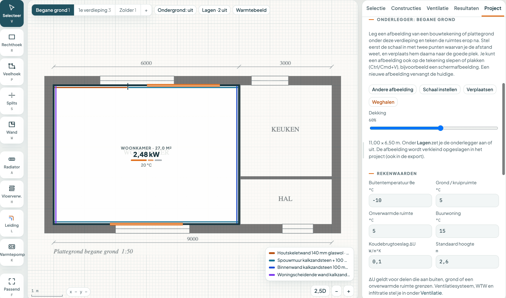

## Wanden intekenen


Je tekent geen losse muren, maar **ruimtes**. Elke zijde van een ruimte is een wand.

1. Kies **Rechthoek** (`R`) en sleep een ruimte, of kies **Veelhoek** (`P`) en klik de hoekpunten. Sluit een veelhoek door op het eerste punt te klikken, te dubbelklikken of op Enter te drukken.
2. Punten klikken vast op het raster (standaard 5 cm, in te stellen onder **Project → Tekenen**) en op hoeken van andere ruimtes. Houd Alt ingedrukt om niet vast te klikken.
3. Met **Selecteer** (`V`) sleep je hoekpunten of een hele ruimte. Dubbelklik op een wand om er een hoekpunt bij te zetten.
4. Klik een ruimte aan en vul in het paneel de naam, ontwerptemperatuur en hoogte in.

### Eerst de omtrek, dan de binnenwanden

Je kunt ook eerst de hele verdieping als één vlak tekenen en dat daarna opdelen:

1. Teken de buitenomtrek met **Rechthoek** of **Veelhoek** en stel de buitenwanden, ramen, vloer en plafond in.
2. Kies **Wand** (`W`). Klik op de rand van de ruimte waar de binnenwand begint. Zet eventueel knikpunten binnen de ruimte voor een wand met een hoek, en klik op de rand waar hij eindigt.
3. Er verschijnt een venster *Ruimte splitsen?*. Het deel dat een nieuwe ruimte wordt, is gemarkeerd. Geef het een naam en kies **Splitsen** (of Enter). Met Esc of **Annuleren** gebeurt er niets.

Beide delen nemen over wat al bij de oorspronkelijke ruimte was ingesteld:

- De **buitenwanden** houden per stuk hun constructie, wat erachter ligt en hun splitsingen. Ramen en deuren gaan mee met het langste deel van het wanddeel waarin ze zaten.
- Temperatuur, hoogte, vloer, plafond en dak blijven gelijk.
- Toevoer en afzuiging worden naar oppervlak verdeeld. Radiatoren en vloerverwarming gaan mee met het deel waarin hun midden ligt.
- De **nieuwe wand** krijgt de eerste wandconstructie die *aan beide kanten binnen* is, en staat op *Automatisch*. Hij grenst dus aan de andere ruimte.

De twee delen delen dezelfde lijn, net als bij hart-op-hart tekenen. Ongedaan maken kan met Ctrl+Z.

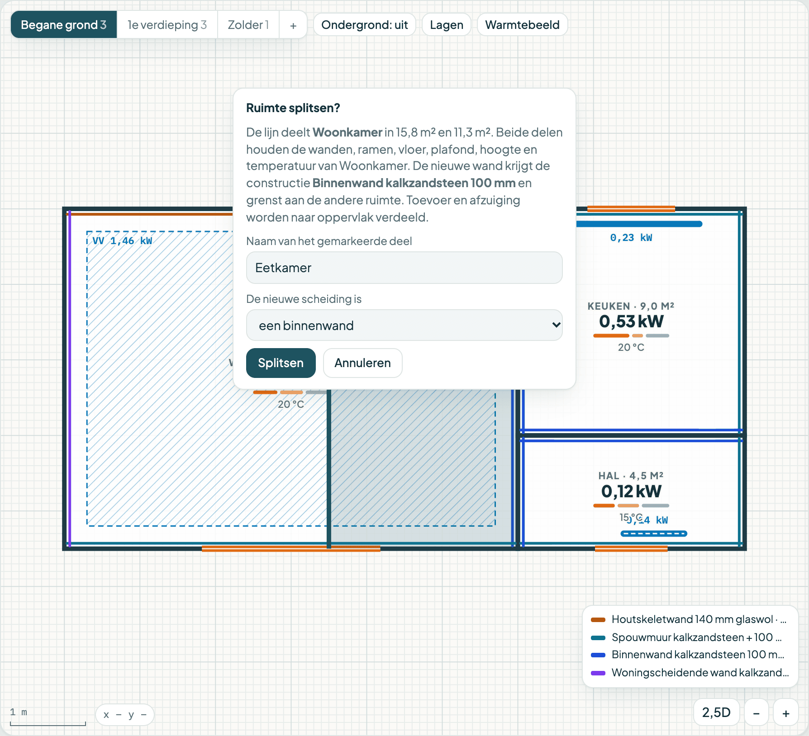

### Vides en trappenhuizen

Een vide of trappenhuis teken je op de laagste verdieping. Kies bij de ruimte *Soort ruimte: Vide* (of *Trappenhuis*) en bij **Loopt door tot** de hoogste verdieping. Op de verdiepingen erboven staat de vide dan gearceerd.

**Bovenkant van een vide.** Ligt er geen ruimte meer boven de vide, omdat hij doorloopt tot onder het dak, dan heeft hij geen plafond maar het dak. De app neemt dan het dak over van de ruimte met een schuin dak ernaast (bijvoorbeeld de zolder): dezelfde constructie en helling, en een dakvlak van vloeroppervlak ÷ cos(helling). Grenzen er meer van zulke ruimtes aan, dan kies je welke. Staat er geen ruimte met een schuin dak naast, dan is het een plat dak en kies je de dakconstructie. Eindigt de vide onder een andere ruimte, dan heeft hij gewoon een plafond.

Klik je op een hogere verdieping de vide aan, dan blijf je op die verdieping en zie je de ruimte in het paneel. Voor de wanden ga je naar de verdieping waar de vide begint.

Teken je op zo'n hogere verdieping een ruimte die over de vide heen valt, dan knipt de app het stuk binnen de vide eruit. Andersom gaat het ook: laat je een bestaande ruimte later doorlopen, dan worden de ruimtes erboven op dezelfde manier geknipt.

- De nieuwe wanden langs de vide worden binnenwanden. Is daar geen muur, maar bijvoorbeeld een balustrade, kies dan bij dat wanddeel **Open verbinding (geen wand)**.
- Ligt de vide helemaal binnen de nieuwe ruimte, dan zou er een gat in de ruimte komen. Dat kan niet, dus de app maakt er twee delen van, met een open verbinding ertussen.
- Valt de ruimte helemaal binnen de vide, dan wordt hij niet toegevoegd.

**De trap tekenen**: staat een ruimte op *Trappenhuis*, dan kies je in het ruimtepaneel de vorm van de trap: **recht**, **kwartslag** (gaat de hoek om, met spillen in de hoek) of **halve draai** (met een bordes). Daarnaast kies je bij welke wand hij begint, langs welke kant hij loopt en hoe breed hij is. In de plattegrond zie je dan de treden met een pijl naar boven. In de 2,5D-weergave staat per verdieping een trap van vloer tot vloer. De app gaat uit van een rechthoekig trapgat. De trap is alleen voor het beeld en telt niet mee in de berekening.

### Schuine daken

Kies bij een ruimte onder *Dak en plafond* een **Zadeldak** of **Lessenaarsdak**, en vul de dakhelling en de **hoogte van de muurplaat** in: de hoogte boven de vloer waar het schuine dak begint, meestal de bovenkant van de gevelmuur. Teken je de ruimte tot een laag wandje op zolder, vul dan de hoogte van dat wandje in. De nokhoogte rekent de app zelf uit met de breedte van de ruimte. Standaard loopt het dak door tot in de nok, met een punt.

Heeft de zolder een vlak plafond, bijvoorbeeld een zoldervloer of hanenbalk, vink dan **Vlak plafond** aan en vul de **Plafondhoogte** in. Alleen het stuk boven die hoogte wordt dan vlak. Komt de nok niet hoger dan het plafond, dan blijft het gewoon een punt. Projecten van voor deze wijziging houden hun vlakke plafond op de hoogte die al was ingevuld.

### Knieschot

Een knieschot is een laag schot onder de schuine kap, bijvoorbeeld op een kwart van de lengte van het spant. Er zit vaak een plaat of luikje in, met bergruimte erachter. Vink bij de ruimte onder *Dak en plafond* **Knieschot** aan en vul de hoogte in. De app laat zien op welke afstand van de gevel het knieschot staat, en tekent het als stippellijn.

Het knieschot is een aanvulling op de tekening en telt niet mee in de berekening: de bergruimte erachter ligt binnen de geïsoleerde schil. De ruimte rekent dus gewoon als één geheel tot aan de gevels.

Wil je de zolder opdelen in kamers, trek dan met **Wand** een lijn van knieschot naar knieschot. De lijn klikt vast op de stippellijnen. De wand staat alleen tussen de knieschotten. Daarachter, in de bergruimte, deelt een open verbinding (stippellijn, geen wand) de zolder verder op tot de gevel.

### Dakramen en dakkapellen

Bij een ruimte met een schuin dak staat onder het dakvlak **Dakramen en dakkapellen**:

- **+ Dakraam**: breedte, lengte langs de helling, constructie (bijvoorbeeld de Uw van het dakraam) en op welk dakvlak. Het oppervlak gaat van het dakvlak af.
- **+ Dakkapel**: breedte, hoogte van de voorkant en het dakvlak, met constructies voor de wanden en het platte dak, en een raam in de voorkant. De app rekent de voorkant, de twee driehoekige zijwangen en het platte dak uit. De diepte volgt uit de hoogte en de dakhelling. Het stuk schuin dak waar de dakkapel staat, gaat eraf, en de inhoud van de ruimte wordt groter.

Waar ze zitten, geef je aan met **Midden langs de nok** en **vanaf de goot**: langs de helling tot de onderkant van een dakraam, of horizontaal tot de voorkant van een dakkapel. Laat je die leeg, dan verdeelt de app ze gelijkmatig over het dakvlak. In de plattegrond staan ze als stippellijn. In de 2,5D-weergave zie je de dakramen in het schuine dakvlak, en de dakkapellen met voorkant, raam, zijwangen en plat dak. De plek telt niet mee in de berekening.

### Kruipruimte en kelder

Onder **Project → Verdiepingen** voeg je met **+ Kruipruimte** of **+ Kelder** een verdieping toe onder de laagste. Ruimtes die je daar tekent, zijn **onverwarmd**: ze tellen niet mee in het warmteverlies. Hun temperatuur (standaard 10 °C voor een kruipruimte en 12 °C voor een kelder) geldt voor de vloer erboven, als die op *Automatisch* staat. Waar niets getekend is, rekent de vloer met de grond. Je kunt er ook leidingen, de warmtepomp of het boilervat tekenen, met stijgleidingen naar boven.

Een verdieping verwijder je onder **Project → Verdiepingen** met ✕. Alles wat erop staat (ruimtes, leidingen en eventueel de warmtepomp) gaat mee, en ongedaan maken kan. Liep een trappenhuis of vide door tot die verdieping, dan stopt hij een verdieping lager.

Elke ruimte kun je met het vinkje **Verwarmde ruimte** ook zelf op onverwarmd zetten, bijvoorbeeld een berging of garage.

### Binnenmaat of buitenmaat?

De muurdikte wordt niet getekend. De getekende lijn is de rand van de ruimte zelf:

- wandoppervlak = lengte van de lijn × hoogte, min ramen en deuren;
- vloer- en plafondoppervlak = het oppervlak binnen de lijnen;
- luchtvolume = vloeroppervlak × hoogte.

Teken daarom **op binnenmaat**, of hart-op-hart als je snel wilt werken. Dat laatste geeft iets te grote oppervlakken. Op binnenmaat mis je aan de buitenkant wat oppervlak bij de hoeken. Daar is de koudebrugtoeslag ΔU voor (standaard +0,1 W/m²K op de buitenschil). Buitenmaat raden we af: dan tel je de muurdikte mee in vloer, plafond en volume, en valt het verlies te hoog uit.

Op binnenmaat zit tussen twee ruimtes een gat ter dikte van de binnenwand. De app ziet twee evenwijdige wanden toch als één gedeelde wand zolang ze minder dan **Max. wanddikte aangrenzing** uit elkaar liggen (standaard 0,35 m, onder **Project → Tekenen**). Is een tussenmuur dikker, bijvoorbeeld een oude dragende muur, zet die waarde dan hoger.

### Uit welke wanden bestaat een ruimte?

Klik een ruimte aan. Onder **Wanden** staat dan elk wanddeel met zijn lengte, constructie en wat erachter ligt. Ga je met de muis over een regel, dan licht die wand op in de tekening. Klik je erop, dan bewerk je dat wanddeel. Dat werkt hetzelfde als wanneer je de wand in de tekening aanklikt.

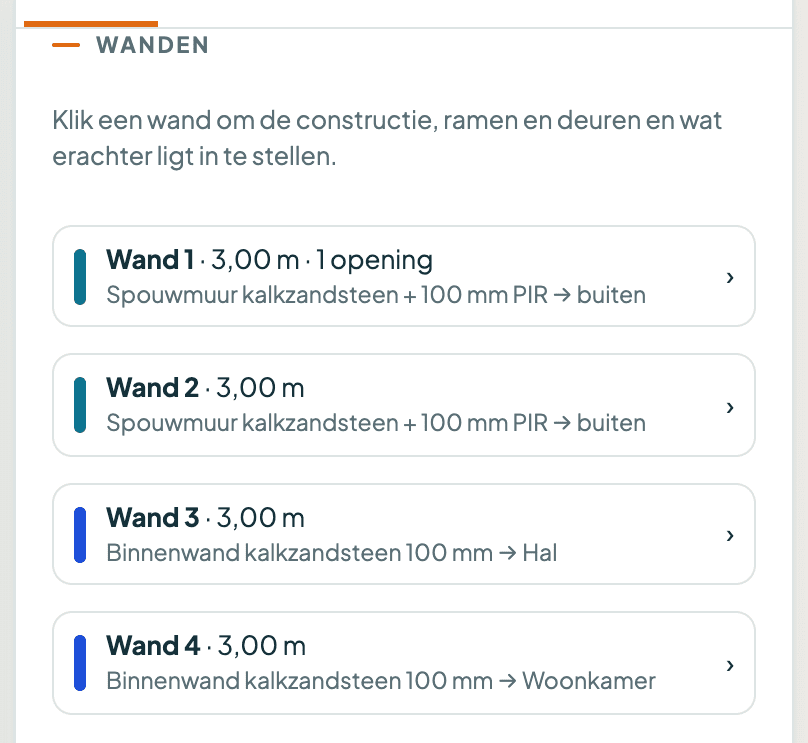

### Wat ligt er achter de wand?

Klik een wand aan om hem te bewerken. Onder **Grenst aan** staat standaard *Automatisch (uit tekening)*: de app kijkt dan in de tekening of er een andere ruimte tegenaan ligt en rekent met de temperatuur van die ruimte. Ligt er niets tegenaan, dan rekent hij met de buitentemperatuur. Je kunt het ook zelf kiezen: buiten, grond / kruipruimte, onverwarmde ruimte, buurwoning of een ruimte met een vaste temperatuur.

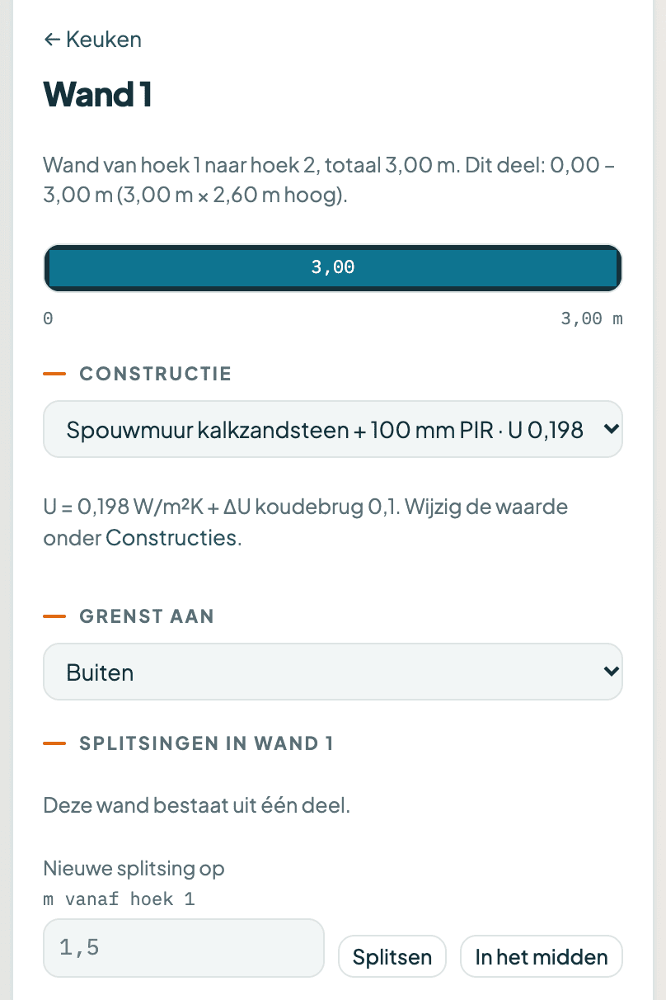

### Vloeren en plafonds

Zet bij een ruimte de vloer en het plafond onder **Grenst aan** op *Automatisch (uit tekening)*. Nieuwe ruimtes staan daar standaard al op. De app zoekt dan zelf uit wat eronder en erboven ligt:

- **Vloer**: de ruimtes op de verdieping eronder, met hoeveel m² elk overlapt. Op de laagste verdieping is dat de grond. Een stuk vloer waar niets onder getekend is (bijvoorbeeld een uitkraging) grenst aan buiten.
- **Plafond**: de ruimtes op de verdieping erboven. Is daar niets getekend, dan is het een plat dak naar buiten. Bij een vlak plafond onder een schuin dak is het de onverwarmde ruimte onder de nok.

Per stuk rekent de app met de temperatuur van die ruimte.

**Twee constructies.** Ligt een deel van een plafond onder een ruimte en een ander deel onder buiten, zoals bij een uitbouw, dan kies je bij het plafond ook een **Constructie waar niets boven ligt (dak)**. Het deel onder de zolder rekent dan bijvoorbeeld met een betonvloer, en het platte dak van de uitbouw met houtskeletbouw. Bij de vloer van een verdieping werkt het net zo, voor een stuk waar niets onder ligt (een overstek). Laat je het leeg, dan geldt de eerste constructie voor het hele vlak. Bij de vloer en het plafond zie je de verdeling, bijvoorbeeld *20,3 m² → Slaapkamer 1 (18 °C)*. Een nieuwe ruimte op een verdieping krijgt als vloerconstructie het plafond van de ruimte eronder.

Bestaande projecten houden hun instellingen. Onder **Project → Vloeren en plafonds** zet je alles in één keer op automatisch (ongedaan maken kan).

### Muren naar de buren

Een woningscheidende muur grenst aan de buurwoning. Staat *Grenst aan* op *Automatisch* en is de buurwoning niet getekend, dan rekent de app die muur als buitenmuur. Dat kan het warmteverlies flink te hoog maken. Heeft de constructie *Aan beide kanten binnen* aangevinkt, zoals een binnenwand of woningscheidende muur, en rekent hij toch naar buiten, dan waarschuwt de app: in het startpaneel, bij Resultaten, bij de ruimte en bij het wanddeel. Met **Zet op Buurwoning** zet je die wanddelen in één keer goed. Een wanddeel dat deels tegen een andere ruimte ligt, wordt eerst op de grens gesplitst, zodat alleen het stuk zonder buurruimte op *Buurwoning* komt.

### Gedeelde wanden

Een wand tussen twee ruimtes hoort bij allebei. Kies je voor zo'n wand een andere constructie, dan krijgt het stuk aan de andere kant dezelfde. De app splitst de wand van de buurruimte daarvoor zo nodig op de grens. Het gedeelde stuk licht in de buurruimte gestippeld op.

Grenst een wanddeel aan meer dan één ruimte, of maar voor een deel aan een andere ruimte? Kies dan **Splitsen op de grens**. Dan wordt het gedeelde stuk een apart wanddeel. Een raam of deur die je in een gedeeld wanddeel zet, verschijnt ook in de andere ruimte. Andere maten en verwijderen gaan aan beide kanten mee. Staan de constructies aan beide kanten nog verschillend, bijvoorbeeld in een ouder project, dan kun je ze met **Constructie gelijk trekken** gelijk maken.

### Wand splitsen

Bestaat een wand uit verschillende delen, bijvoorbeeld een stuk buitenmuur en een stuk binnenwand, of een geïsoleerd en een ongeïsoleerd deel? Gebruik dan **Splits** (`S`) en klik op de plek waar de wand verandert. Je kunt de splitsing ook op een exacte afstand vanaf de hoek invullen. Elk deel krijgt een eigen constructie en een eigen **Grenst aan**.

### Ramen en deuren

Klik het wanddeel aan en kies **+ Raam of deur**. Vul de breedte, hoogte en constructie in. Het oppervlak gaat automatisch van de wand af.

Een nieuw raam staat in het midden van het wanddeel. Wil je het verplaatsen, sleep het dan in de plattegrond over de muur. Tijdens het slepen zie je de afstand tot beide uiteinden. Je kunt de plek ook precies invullen bij **Begint op** (in meter vanaf de hoek waar de wand begint). Een raam of deur blijft binnen zijn eigen wanddeel. Met **Onderkant** geef je aan hoe hoog het raam boven de vloer begint. Standaard staat een deur (vanaf 1,9 m hoog) op de vloer en begint een raam op 0,9 m. Voor de berekening maken de plek en de hoogte niet uit, maar in de tekening en de 2,5D-weergave staat het raam dan wel goed. Komt het raam boven de wand uit, dan waarschuwt de app.

**Binnendeuren**: een deur in een wand tussen twee ruimtes rekent met de temperatuur van de ruimte erachter, niet met buiten. Zet je een opening in een gedeeld wanddeel, dan wordt het automatisch een *Binnendeur, niet geïsoleerd* (U ≈ 2,2 W/m²K, indicatief), en die verschijnt in beide ruimtes. Bestaande projecten krijgen die constructie er één keer bij.

Vul bij breedte en hoogte de **buitenmaat van het kozijn** in (het gat in de muur), niet de dagmaat. Gebruik daarbij de **Uw** van het hele raam, dus glas en kozijn samen, en niet de Ug van alleen het glas.

### Open verbinding: geen wand tussen twee ruimtes

Soms is de scheiding tussen twee ruimtes geen muur, bijvoorbeeld waar de hal overgaat in de trapvide, of tussen een keuken en een woonkamer zonder tussenwand. Kies dan bij het wanddeel onder **Grenst aan** voor **Open verbinding (geen wand)**. Dan gebeurt er het volgende:

- Dat stuk telt niet mee voor de warmte die van de ene naar de andere ruimte gaat, en het heeft geen constructie nodig.
- De andere ruimte krijgt hier vanzelf ook een open verbinding.
- In de tekening is het een stippellijn, en in de 2,5D-weergave staat er geen muur.
- Hebben de twee ruimtes een andere temperatuur, dan waarschuwt de app. Bij een open verbinding is de temperatuur in de praktijk ongeveer gelijk.
- Lucht stroomt er vrij. Geef onder **Ventilatie** de overstroom op als de ene ruimte lucht toevoert en de andere afzuigt.

Trek je met **Wand** een nieuwe scheiding, dan kies je in het venster meteen of het een binnenwand of een open verbinding wordt.

### 2,5D-weergave

Met de knop **2,5D** rechtsonder, of de toets `D`, zie je de woning schuin van boven. De verdiepingen tot en met de gekozen verdieping staan op elkaar. Wanden hebben de kleur van hun constructie, en ramen en deuren zijn oranje. Om te draaien en te kantelen sleep je met ingedrukt scrollwiel, of met Shift + slepen. De weergave draait dan om het punt waar je begon met slepen. Gewoon slepen schuift, en scrollen zoomt rond de muis. Klik een vloer of wand aan om hem in het paneel te bewerken. Tekenen doe je in de plattegrond: kies je een tekengereedschap, dan schakelt de app daar vanzelf naar terug.

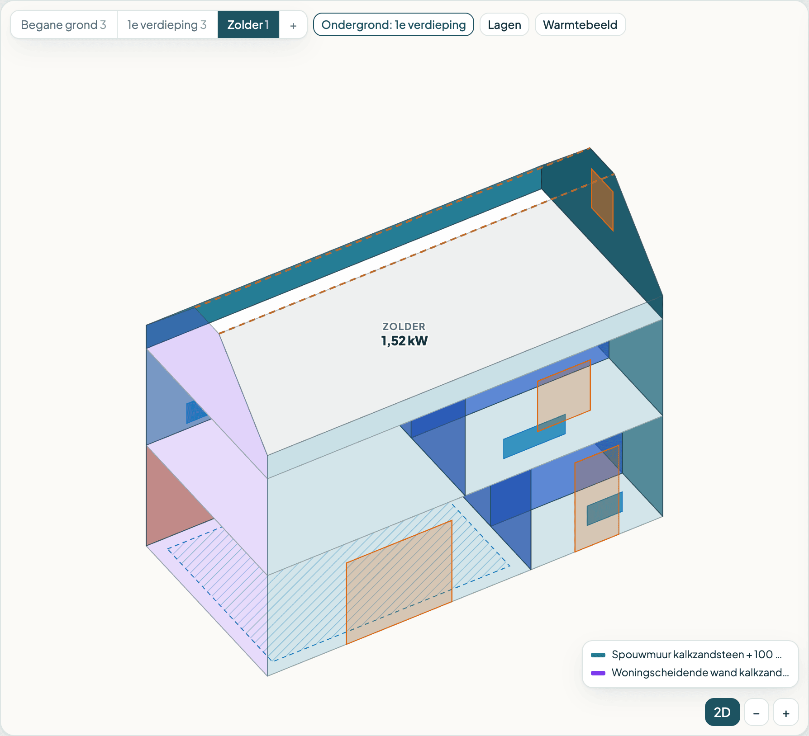

### Warmtebeeld: waar verlies je de meeste warmte?

Met de knop **Warmtebeeld** boven de tekening kleurt elk vlak naar zijn warmteverlies per m² bij de ontwerptemperatuur: groen is weinig, rood is veel. Zo zie je in één oogopslag waar je het meeste verliest, bijvoorbeeld een slecht geïsoleerd dak of enkel glas. Het werkt in de plattegrond (wanden en ramen) en in de 2,5D-weergave (ook vloeren, daken en plafonds naar buiten of een onverwarmde ruimte). Grijs betekent geen verlies, bijvoorbeeld een wand tussen twee ruimtes van dezelfde temperatuur. Het verlies per m² is (U + ΔU) × het temperatuurverschil, dus een wand naar de buren (15 °C) kleurt groener dan dezelfde wand naar buiten. Nog een keer klikken zet de gewone kleuren per constructie terug.

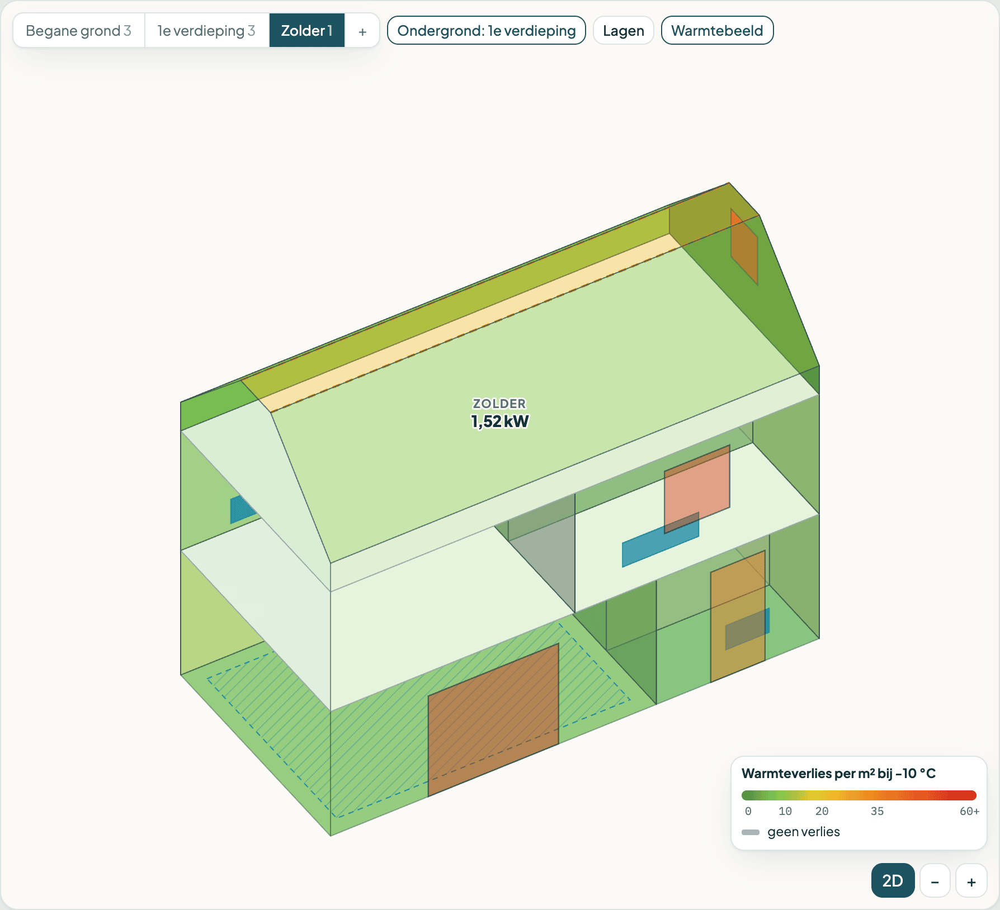

## Ventilatie en luchtstromen

Onder **Ventilatie** kies je het systeem (A, C of D met WTW) en vul je per ruimte de inblaas of toevoer en de afzuiging in m³/h in.

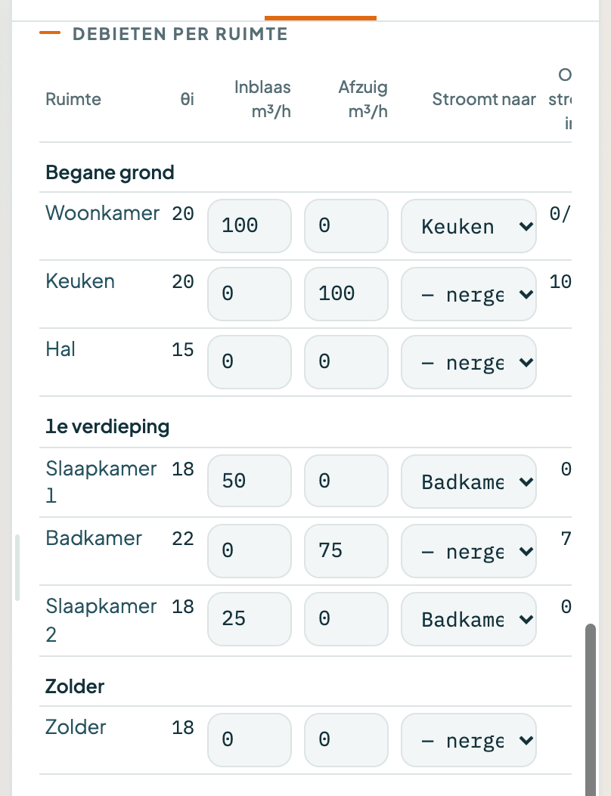

Per ruimte geef je bij **Lucht stroomt over naar** aan waar de lucht heen gaat: via een spleet onder de deur, een overstroomrooster of een open verbinding. Bijvoorbeeld slaapkamer → overloop → badkamer. Je kiest dat bij de ruimte zelf, of in de tabel onder Ventilatie. Hoeveel lucht het is, rekent de app zelf uit: wat er na de afzuiging in die ruimte overblijft, plus wat er uit andere ruimtes binnenkomt. Zo telt een keten vanzelf op. De ontvangende ruimte rekent met de temperatuur van de ruimte waar de lucht vandaan komt.

In het tabblad Ventilatie laat de plattegrond de luchtstromen zien als bewegende pijlen met m³/h, en per ruimte de inblaas en afzuiging. Selecteer je een ruimte, dan zie je de stromen van en naar die ruimte. Stroomt lucht naar een andere verdieping, dan staat dat bij de ruimte (↑ naar Overloop 50 m³/h).

Gaat lucht uit één ruimte naar meer dan één andere ruimte, vul dan de vaste aftakking in bij **Handmatige overstroom (geavanceerd)**, bijvoorbeeld hal → toilet 20 m³/h. Kies daarnaast bij *Stroomt naar* de ruimte die de rest krijgt, bijvoorbeeld hal → woonkamer. Die rest rekent de app automatisch uit. Blijft er in een ruimte lucht over die nergens heen gaat, dan staat bij die ruimte hoeveel er binnenkomt en hoeveel eruit gaat.

### Infiltratie

Onder **Ventilatie → Infiltratie** reken je de luchtlekkage van de woning uit met de **qv10**: de lekkage bij 10 Pa drukverschil, in dm³/s per m² vloeroppervlak. De app rekent met 0,46 × qv10 × vloeroppervlak × correctiefactor, en verdeelt dat over de ruimtes naar hun oppervlak aan de buitenschil. Ken je de qv10 van je huis niet, gebruik dan de richtwaarden bij het veld. Wil je het zeker weten, laat dan een blowerdoortest doen: die meet de echte qv10.

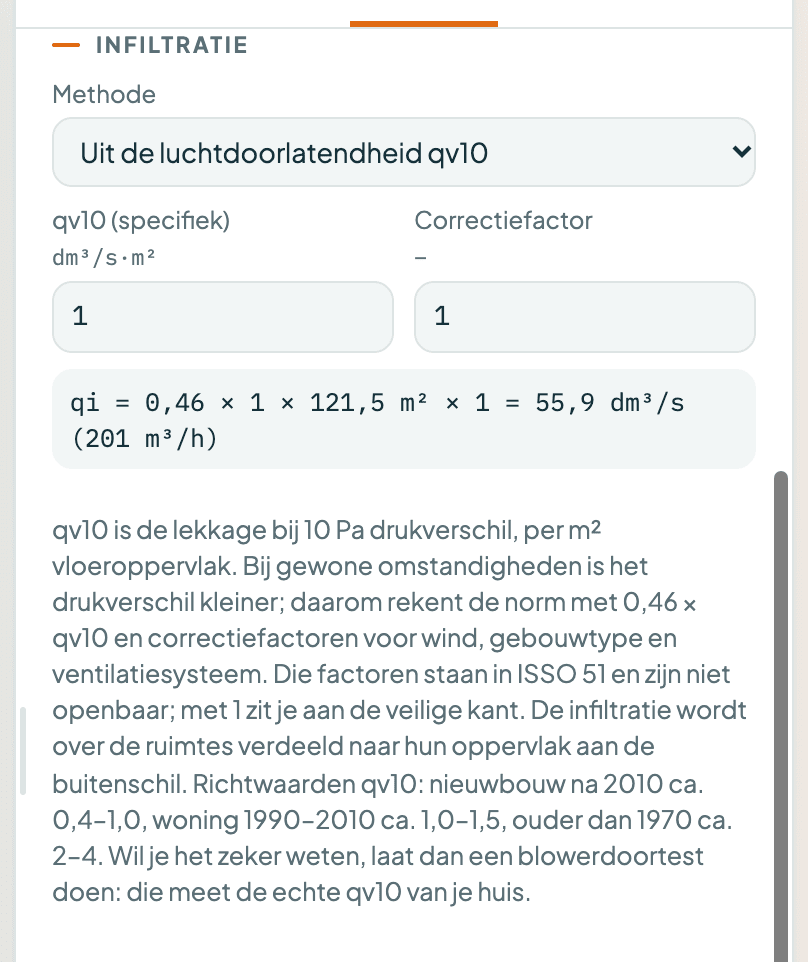

## Stooklijn

Een warmtepomp stelt de aanvoertemperatuur in op de buitentemperatuur: hoe kouder het buiten is, hoe warmer het water. Dat verband heet de **stooklijn** (ook weerafhankelijke regeling of heating curve). Een warmtepomp werkt grofweg 2 à 3 % zuiniger per graad lagere aanvoer, dus een stooklijn die niet hoger staat dan nodig, loont.

Onder **Resultaten → Stooklijn** rekent de app voor elke buitentemperatuur van de ontwerptemperatuur tot +15 °C uit welke aanvoertemperatuur nodig is. Het warmteverlies van elke ruimte neemt daarbij evenredig af met het verschil tussen binnen en buiten, en de app zoekt de laagste aanvoer waarbij de radiatoren en de vloerverwarming dat nog dekken. Je ziet:

- de berekende lijn, en de rechte lijn die je op de warmtepomp instelt: het **eindpunt** bij de laagste buitentemperatuur en het **voetpunt** bij +15 °C;
- de helling;
- de **maatgevende ruimte**: de ruimte die de hoogste aanvoer nodig heeft. Vergroot je daar de afgifte, dan kan de hele lijn omlaag.

De berekening gaat uit van één aanvoertemperatuur voor het hele huis, met de ΔT tussen aanvoer en retour uit het project. Stel de lijn daarna in de praktijk bij.

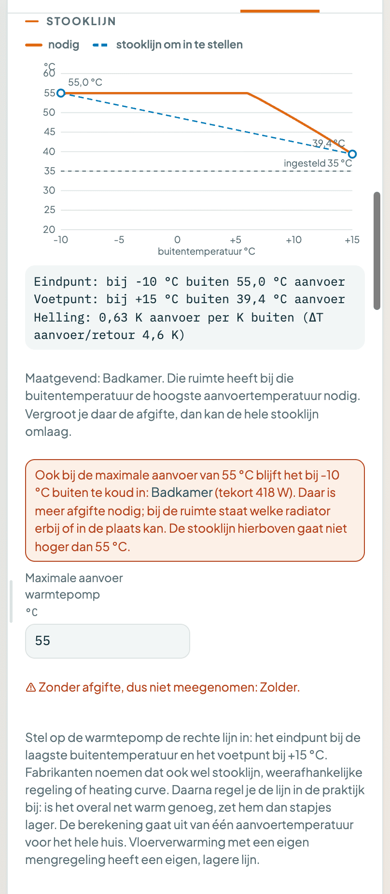

## Radiatoradvies

Is de afgifte in een ruimte te klein bij de ingestelde aanvoer- en retourtemperatuur, dan staat bij die ruimte onder *Afgifte* een advies:

- hoeveel vermogen er extra nodig is, gerekend bij 75/65/20 °C zoals het in de catalogus staat;
- **bijplaatsen**: de minimale lengte van een extra paneelradiator (T21, T22, T33) bij 400, 500, 600 en 900 mm hoogte;
- **vervangen**: dezelfde tabel voor één radiator die de hele ruimte verwarmt;
- **boosters**: of ventilatoren onder de bestaande radiator het tekort zouden dekken.

Onder Resultaten staat welke ruimtes een tekort hebben. De lengtes komen uit de vuistregel in `data/radiatoren.json` (±10 %). Kies uiteindelijk uit de tabel van de fabrikant.

## Vloerverwarming

Kies **Vloerverw.** (`H`) en klik de hoekpunten. Zo teken je ook een L-vorm. Sluit af door op het eerste punt te klikken, te dubbelklikken of op Enter te drukken. Slepen geeft nog steeds een rechthoek. Moet de hele ruimte vloerverwarming krijgen, klik dan bij de ruimte onder *Afgifte* op **Vloerverwarming in de hele ruimte**. De app tekent die dan op 10 cm van de wanden.

De vorm pas je aan door de vloerverwarming te selecteren:

- sleep een hoekpunt om het te verplaatsen;
- klik op een **+** halverwege een zijde om een hoekpunt toe te voegen;
- dubbelklik op een hoekpunt om het weg te halen.

## Leidingen en systeeminhoud

Met **Leiding** (`L`) teken je een eenvoudig leidingnetwerk, bijvoorbeeld van de warmtepomp naar de verdeler en de radiatoren. Eén lijn staat voor aanvoer en retour samen. Klik de punten en rond af met dubbelklik of Enter. Per leiding kies je het materiaal (koper, (alu)pex of staal) en de diameter, bijvoorbeeld alupex 32×3 mm. Bij **Extra lengte** vul je stukken in die je niet tekent, zoals een stijgleiding naar een andere verdieping. Je ziet de inhoud van de leiding en hoeveel vermogen hij bij 0,5 m/s kan transporteren.

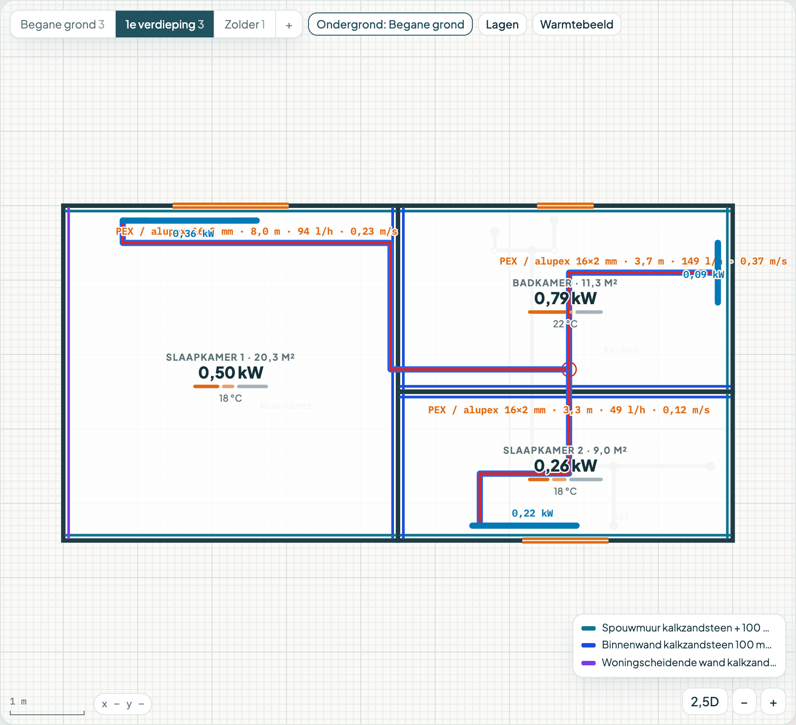

Onder **Resultaten → Systeeminhoud** telt de app de waterinhoud op: getekende leidingen, radiatoren, convectoren, vloerverwarmingslussen, de warmtepomp en eventueel een schakelvat. Dat vergelijkt hij met wat de gekozen warmtepomp nodig heeft:

- staat in de warmtepomplijst een `minInhoud` (liter), dan geldt die;
- anders rekent de app met een vuistregel (standaard 15 liter per kW maximaal vermogen bij +7 °C, aan te passen).

Is de inhoud te klein, dan adviseert de app een schakelvat: dat vergroot de systeeminhoud. Tel in gedachten alleen kringen mee die altijd open staan: thermostaatkranen en ruimteregeling verkleinen de werkelijke inhoud. Een buffervat tussen aanvoer en retour (hydraulische scheiding) is iets anders. Dat heb je nodig als de warmtepomp meer water moet rondpompen dan het afgiftesysteem aankan, of bij extra pompgroepen. Of dat nodig is, volgt uit het debiet (zie *Debiet van de warmtepomp*), niet uit de inhoud. De waterinhoud van radiatoren is een schatting per meter of per kW. Bij een convector loopt er meestal een lus koperbuis van 15 mm door de lamellen, over de lengte min ongeveer 15 cm. Een lus is twee buizen, en een dubbele convector heeft twee lussen (vier buizen). Kies het aantal lussen bij de convector. Bij elk afgifte-element zie je de geschatte inhoud.

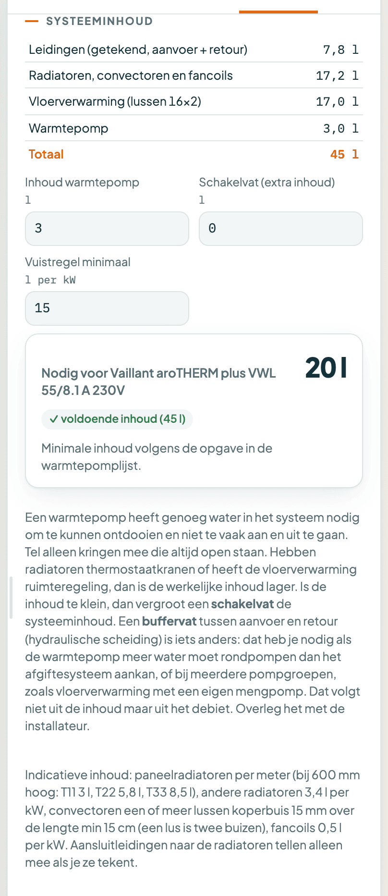

### Leidingnet, debiet en indexcircuit

Plaats met **Warmtepomp** (`K`) de warmtepomp, of de plek waar de leidingen van het buitendeel binnenkomen. Teken daarna met **Leiding** de leidingen vanaf dat punt. De app maakt er een netwerk van:

- **Vastklikken**: een leiding klikt vast op de warmtepomp, op de uiteinden van radiatoren en convectoren, op de hoeken van vloerverwarming en op andere leidingen. Eindigt een leiding óp een andere leiding, dan is dat een T-stuk.
- **Stijgleidingen**: laat een leiding op twee verdiepingen op precies hetzelfde punt eindigen. Met *Ondergrond* op de verdieping eronder zie je de leidingen daarvan lichtgrijs, met hun punten als stip. Met het gereedschap Leiding zie je ook die van de verdieping erboven, gestippeld. Klik op zo'n punt (de cirkel toont dan *stijgleiding*), dan worden de leidingen verticaal verbonden (↕). De lengte volgt uit het hoogteverschil tussen de verdiepingen.
- **Aangesloten**: een radiator of vloerverwarming hangt aan het leidingnet als er binnen 30 cm een leidingpunt ligt. Geen leiding betekent geen verbinding.
- **Aansluitleiding**: die vul je niet apart in. De app neemt de getekende leiding waar het element aan hangt, en controleert met de maat daarvan de stroomsnelheid. Een andere maat kies je bij de leiding zelf. In het paneel van het element klik je door naar die leiding.

Vanaf de warmtepomp rekent de app per leidingstuk het debiet (de som van alles erachter), de stroomsnelheid en het drukverlies (Darcy-Weisbach, aanvoer + retour, met een instelbare opslag voor bochten en koppelingen). Het debiet per element is zijn aandeel in het warmteverlies van de ruimte, bij de ΔT tussen aanvoer en retour.

Het **indexcircuit** is de route naar het element met het grootste totale drukverlies: leidingen plus het element zelf. Het licht oranje op in de plattegrond. Onder **Resultaten → Leidingnet en indexcircuit** zie je:

- per element het debiet, het drukverlies en hoeveel extra weerstand het nodig heeft om goed ingeregeld te zijn ten opzichte van het indexcircuit;
- leidingstukken waar het water sneller stroomt dan 0,5 m/s;
- elementen die niet zijn aangesloten, en lussen in het net.

Met **Schema van het leidingnet** (onder Resultaten of bij de warmtepomp) zie je het hele circuit als schema: van de warmtepomp naar alle aangesloten elementen. Rechte stukken zonder aftakking zijn samengevoegd. Per stuk zie je de maat, de lengte, het debiet, de snelheid en waar een stijgleiding naar een andere verdieping gaat. Per element zie je het vermogen, het debiet, het drukverlies en het inregeladvies. Het indexcircuit is oranje. Een leiding die nergens heen gaat, staat er als *loos eind* in. Klik op een element om het te openen, of druk het schema af.

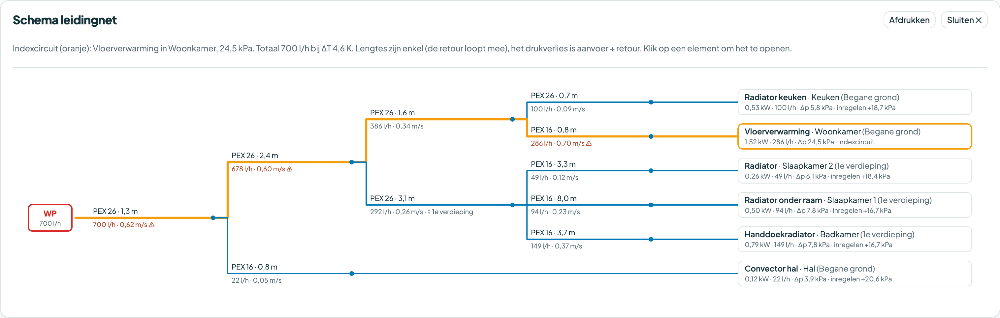

In een gesloten cv-systeem hoeft de pomp het water niet omhoog te pompen. Hij moet alleen de weerstand overwinnen, en dat is het drukverlies van het indexcircuit. Zet je bij een warmtepomp in `data/warmtepompen.json` de `restopvoerhoogte` (kPa), dan vergelijkt de app die ermee.

De weerstand van een element is indicatief: 3 kPa voor een radiator of convector met kraan, 10 kPa voor een fancoil. Vloerverwarming rekent de lussen van 16×2 mm, verdeeld over groepen van hoogstens 100 m, plus 2 kPa voor de verdeler.

## Radiatorvermogen

Klik een radiator aan. De lengte verander je door een uiteinde in de tekening te slepen, of door hem in te vullen bij **Lengte** (mm). Dat werkt ook voor convectoren en fancoils. Onder **Vermogen bepalen** kies je:

- **Zelf invullen**: het vermogen bij 75/65/20 °C van de typeplaat of uit de catalogus. Bij convectoren en fancoils kan alleen dit, want hun vermogen hangt te veel af van de bouwvorm.
- **Een paneeltype** (T10, T11, T20, T21, T22 of T33): vul de hoogte en lengte in mm in. De app schat het vermogen met een vuistregel: het vermogen per meter bij 600 mm hoogte, maal (hoogte / 600)^0,9, maal de lengte. Een T22 van 600 × 1000 mm geeft zo 1700 W. Reken op ongeveer ±10 %. Ken je merk en model, neem dan de waarde uit de tabel van de fabrikant.

Bij elk element staat hoe de app het vermogen omrekent naar jouw aanvoer- en retourtemperatuur: vermogen × (temperatuurverschil nu / temperatuurverschil bij 75/65/20 °C)^n. Bij 35/30 °C geeft een radiator ongeveer een zesde van zijn vermogen bij 75/65 °C.

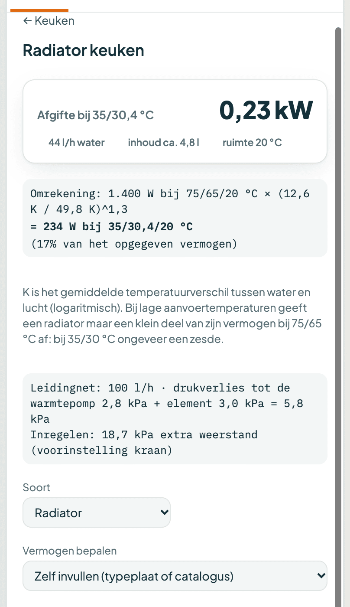

### Debiet van de warmtepomp

Onder **Afgiftesysteem** (bij *Resultaten* of bij een radiator) vul je de aanvoertemperatuur in, en óf de retourtemperatuur, óf het **debiet** van de warmtepomp in l/h.

- **Retourtemperatuur ingevuld:** het debiet volgt uit het vermogen: debiet = vermogen / (1,163 × ΔT). Bij een klein huis en ΔT 5 K komt daar vaak een laag debiet uit.
- **Debiet ingevuld** (bijvoorbeeld 700 of 1000 l/h): dan volgt de ΔT uit het vermogen, en daaruit de retourtemperatuur. Een hoger debiet geeft een kleinere ΔT, een hogere gemiddelde watertemperatuur en dus meer afgifte van de radiatoren en convectoren. De stooklijn kan daardoor iets omlaag. Tegelijk stroomt er meer water door de leidingen, dus het drukverlies van het indexcircuit en de stroomsnelheid nemen toe.

Staat bij de gekozen warmtepomp in `data/warmtepompen.json` een `minDebiet`, dan waarschuwt de app als het debiet daaronder ligt. Onder het minimale debiet gaat een warmtepomp pendelen of in storing. Kan het afgiftesysteem het minimale debiet niet aan, dan is een buffervat tussen aanvoer en retour nodig.

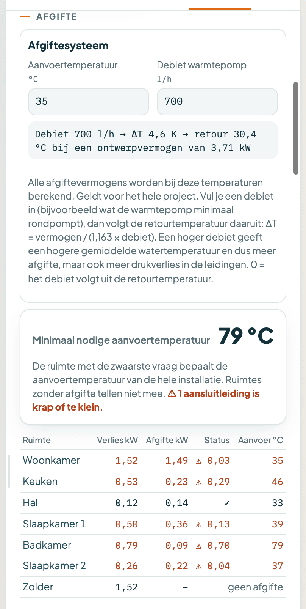

## Warmtepomp kiezen

Onder **Resultaten → Warmtepomp** vergelijk je de warmtepompen uit `data/warmtepompen.json` met het warmteverlies van je huis. De grafiek toont het warmteverlies over de buitentemperatuur, met het maximale en minimale vermogen van de gekozen warmtepomp. Een geschikte warmtepomp dekt bij de ontwerptemperatuur het verlies, en kan bij +10 °C ver genoeg terugregelen zodat hij niet steeds aan- en afslaat (pendelen). Per warmtepomp zie je vanaf welke buitentemperatuur hij pendelt.

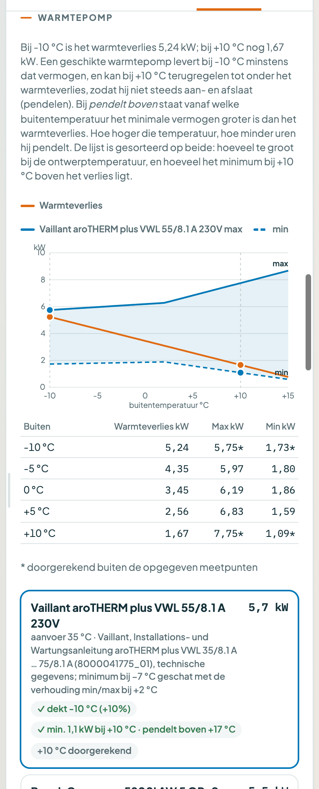

## Isolatiewaarde bepalen

De isolatiewaarde leg je vast in een **constructie**, die je daarna aan wanden koppelt. Een constructie gebruik je op zoveel wanden als je wilt. Pas je hem aan, dan verandert de berekening overal mee.

### 1. Constructie maken

Ga naar het tabblad **Constructies** en kies bij *Wand* **+ Wand**. Geef hem een herkenbare naam, bijvoorbeeld "Spouwmuur 1975 na-geïsoleerd", en kies een kleur. Die kleur zie je terug in de tekening.

Bij **Invoer** kies je hoe je de isolatiewaarde opgeeft.

**U-waarde invullen.** Ken je de U-waarde of Rc al, uit een bouwtekening, energielabel, productblad of [ubakus.de](https://www.ubakus.de/u-wert-rechner/), vul hem dan direct in. U en Rc rekenen automatisch in elkaar om. Voor ramen en deuren is dit de gebruikelijke manier. Neem de Uw van het hele raam (glas met kozijn) van de leverancier. Het voorbeeldproject rekent voor HR++ glas in een houten kozijn met U = 1,8.

**Opbouw in lagen.** Weet je waar de muur uit bestaat, bouw hem dan op uit lagen, **van binnen naar buiten**. Voeg per laag een materiaal en de dikte in mm toe. De app rekent per laag R = d / λ uit en telt alles op tot de Rc en de U-waarde. Een spouwmuur ziet er bijvoorbeeld zo uit:

| Laag | Materiaal | Dikte |
|---|---|---|
| 1 | Kalkzandsteen | 100 mm |
| 2 | Isolatie (bijv. PIR-isolatieplaat of glaswol) | 60 mm |
| 3 | Luchtspouw, zwak geventileerd | 40 mm |
| 4 | Baksteen | 100 mm |

Een paar dingen om op te letten:

- **Luchtspouw**: kies of de spouw niet, zwak of sterk geventileerd is. Een gewone spouwmuur met open stootvoegen is meestal *zwak geventileerd*. Bij een sterk geventileerde spouw, zoals achter een geventileerde gevelbekleding, tellen de spouw en alles daarbuiten niet mee. Zo schrijft NEN-EN-ISO 6946 het voor.
- **Stijlen of regels**: zit de isolatie tussen houten stijlen, kies dan bij die laag **+ stijlen, regels of metal studs in deze laag** en vul het aandeel hout in, bijvoorbeeld 10 %. De app rekent dan met het gemiddelde van de boven- en ondergrens.
- **Metal stud (gipswanden)**: bouw de wand op als gipskartonplaat, isolatie en gipskartonplaat. Voeg aan de isolatielaag stijlen toe met het materiaal *Staal (metal stud-profiel)* en een aandeel van ongeveer 0,1 %. Dat hoort bij een profiel van 0,6 mm dik op 600 mm hart-op-hart. Het staal geleidt zo goed dat de Rc daardoor ongeveer een kwart lager uitvalt. Neem de uitkomst als schatting: NEN-EN-ISO 6946 is niet bedoeld voor metaal dat door de isolatie heen loopt.
- **Materialen**: onderaan het tabblad staat de materialenlijst met indicatieve λ-waarden. Pas ze aan of voeg materialen toe. Neem voor isolatie liefst de λD van het productblad.
- **Binnenwanden**: vink *Aan beide kanten binnen* aan. Dan geldt aan beide kanten de binnen-overgangsweerstand.

De doorsnede bovenaan de kaart toont het temperatuurverloop door de wand bij de ontwerptemperatuur. Lagen die niet meetellen worden lichter weergegeven.

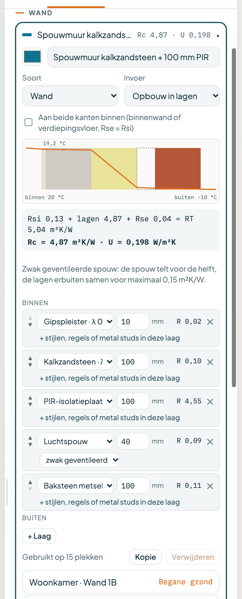

### 2. Constructie koppelen aan een wand

Klik in de tekening een wand of wanddeel aan en kies onder **Constructie** de juiste opbouw. Nieuwe ruimtes krijgen standaard de eerste wandconstructie uit de lijst. Loop dus na of elke wand de goede heeft. Ontbreekt er ergens een constructie, dan zie je bij de ruimte *⚠ constructie ontbreekt*.

Onder **Verlies van dit deel** zie je direct wat dit wanddeel aan warmte verliest: oppervlak × (U + ΔU) × temperatuurverschil. Vloer, plafond en dak stel je op dezelfde manier in bij de ruimte zelf, onder *Vloer* en *Dak en plafond*.

## Rekenmethode

Vereenvoudigde methode op basis van NEN-EN 12831 / ISSO 51:

- transmissie: A × (U + ΔU) × Δθ
- ventilatie: 0,335 × q × (θi − θtoevoer)
- infiltratie: 0,335 × qi × (θi − θe)

Grond rekent met een vaste vervangende temperatuur. Opwarmtoeslag en de exacte correctiefactoren uit ISSO 51 zitten er niet in. **Controleer de uitkomst voordat je erop dimensioneert.**

## Gegevens aanpassen (map `data/`)

De tabellen waar de app mee rekent, staan als JSON in de map `data/`. Je kunt ze aanpassen zonder de code aan te raken. Elk bestand begint met een `toelichting` die uitlegt wat de velden betekenen.

| Bestand | Inhoud |
|---|---|
| `warmtepompen.json` | Standaardlijst warmtepompen: minimaal en maximaal vermogen bij een paar buitentemperaturen (35 °C aanvoer), en optioneel `minInhoud` (minimale systeeminhoud in liter), `restopvoerhoogte` (kPa), `minDebiet` (l/h), `punten55` (vermogen bij 55 °C aanvoer) en `koelen` (koelvermogen). De lijst bevat R290-warmtepompen van Itho Daalderop, Vaillant, WeHeat, NIBE, Viessmann, Bosch en Stiebel Eltron, met de waarden uit de installatiehandleidingen en datasheets van de fabrikant. Bij elke warmtepomp staat de bron, en welke waarden geschat zijn. |
| `materialen.json` | Materialen voor de laagopbouw van constructies (λ-waarde, vaste R of luchtspouw). Geldt voor nieuwe projecten. |
| `leidingen.json` | Leidingtypes (koper, alupex, staal) met per buitendiameter de binnendiameter. |
| `radiatoren.json` | Paneeltypes (T10 t/m T33) met vermogen en waterinhoud per meter bij 600 mm hoogte. |
| `vloerverwarming.json` | Vloerafwerkingen (warmteweerstand) en de afgiftecoëfficiënt per hart-op-hartafstand. |

Verander de sleutels en id's van bestaande regels niet, want projecten verwijzen ernaar. Voeg je een regel toe, geef die dan een nieuwe, unieke id. Na een wijziging ververs je de pagina. Is een bestand geen geldige JSON meer, dan meldt de app dat bij het opstarten.

De warmtepomplijst kun je in de app ook downloaden, aanvullen en als eigen lijst weer importeren. Die eigen lijst staat dan alleen in je browser. Bijdragen met fabrieksgegevens zijn welkom; vermeld de bron.

## Opbouw van de code

Geen build-stap en geen afhankelijkheden: gewone JavaScript-bestanden die `index.html` op volgorde laadt.

```
index.html        de pagina
css/app.css       opmaak
data/*.json       gegevens (zie hierboven)
js/analytics.js   anonieme bezoekersstatistiek (GoatCounter), alleen als er een code is ingevuld
js/data.js        laadt data/*.json
js/core.js        constanten, voorbeeldproject, normalizeProject (oude projecten bijwerken)
js/geometry.js    wanden, buurruimtes, gedeelde wanden, ramen, vloeren en plafonds
js/calc.js        laagopbouw, daken en de warmteverliesberekening
js/render.js      plattegrond, trappen en de 2,5D-weergave
js/interaction.js gereedschappen, bewerkingen, muis en toetsenbord
js/underlay.js    onderlegger: afbeelding onder een verdieping, schaal en plaats
js/panel.js       zijpaneel: ruimte, wanddeel, constructies
js/emitters.js    afgifte, leidingen en systeeminhoud
js/hydraulics.js  leidingnet: debiet, drukverlies, indexcircuit
js/schema.js      schema van het leidingnet (boom vanaf de warmtepomp)
js/sizing.js      stooklijn en radiatoradvies
js/heatpumps.js   warmtepompen en verbeteradviezen
js/views.js       resultaten, ventilatie, project, invoer en knoppen
js/report.js      printbaar rapport (PDF)
js/io.js          export (JSON, CSV, heatlossjs)
js/storage.js     opslaan
js/main.js        opstarten
```

De code is opgemaakt met [Prettier](https://prettier.io) (instellingen in `.prettierrc.json`), bijvoorbeeld met `npx prettier --write "js/*.js" css/app.css index.html "data/*.json"`.

## Privacy en statistiek

Je projecten, tekeningen en onderleggers blijven in je eigen browser. De app stuurt ze nergens naartoe.

De site op GitHub Pages telt anoniem bezoeken met [GoatCounter](https://www.goatcounter.com): zonder cookies en zonder persoonsgegevens. Daarnaast telt hij hoe vaak een paar functies worden gebruikt: het rapport, het schema van het leidingnet, exporteren (JSON, CSV, heatlossjs) en het plaatsen van een onderlegger. Daarbij gaat alleen de naam van de functie mee, nooit de inhoud van een project. Er wordt niets geteld als je de app lokaal draait, als je browser "Do Not Track" aan heeft staan, of als je onder **Project → Statistiek** het vinkje uitzet.

### Statistiek instellen (voor wie de app zelf host)

1. Maak een gratis account aan op [goatcounter.com](https://www.goatcounter.com) en kies een code, bijvoorbeeld `mijntekentafel`. Je statistiek staat dan op `https://mijntekentafel.goatcounter.com`.
2. Vul die code in bovenaan `js/analytics.js`: `const GOATCOUNTER_CODE = 'mijntekentafel';`
3. Commit en push. Na een paar minuten verschijnen de eerste bezoeken in het dashboard. Gebruik van functies staat er als *actie/rapport*, *actie/export-json*, enzovoort.

Laat je de code leeg, dan laadt de app geen enkel extern script behalve Google Fonts.

## Licentie

[MIT](LICENSE)
