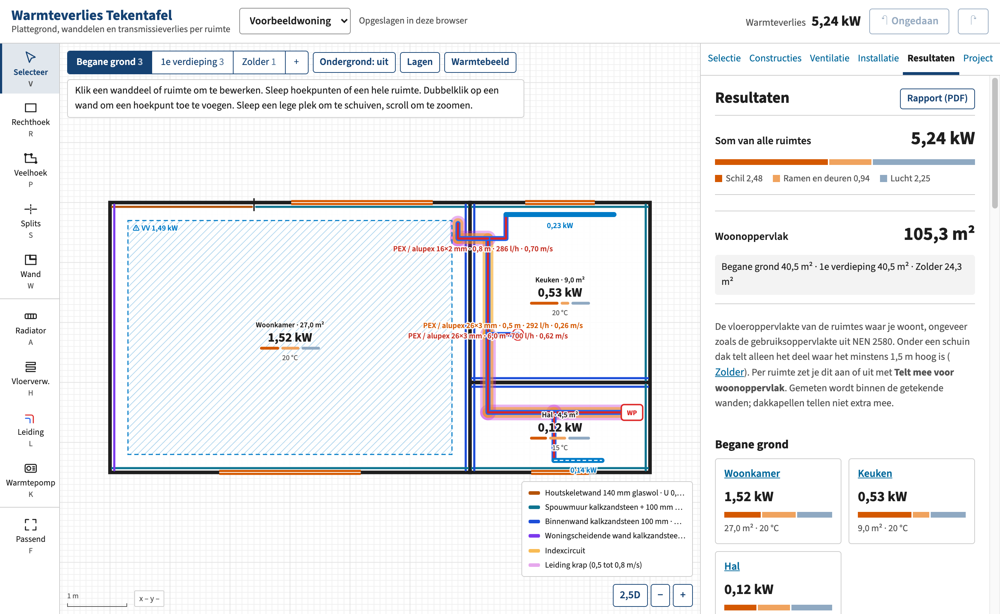

# Warmtepomp Tekentafel

Teken de plattegrond van je woning en zie direct het warmteverlies per ruimte. Daarnaast rekent de app de afgifte van radiatoren en vloerverwarming door en laat zien welke warmtepomp past.

**[Open de app →](https://warmtepomptekentafel.nl/)**

## Wat het doet

- **Tekenen**: ruimtes als rechthoek of veelhoek, binnenwanden trekken die een ruimte in tweeën delen, meerdere verdiepingen met een andere verdieping als lichtgrijze ondergrond, trappenhuizen en vides die doorlopen.
- **Wanddelen**: splits een wand in delen met elk een eigen constructie. De app herkent aan welke ruimte een wand grenst. Een wand tussen twee ruimtes heeft aan beide kanten dezelfde constructie en deuren.
- **2,5D-weergave**: bekijk de verdiepingen gestapeld en van opzij. Klik een vloer of wand aan om hem te bewerken.
- **Warmtebeeld**: kleur elk vlak van groen tot rood naar zijn warmteverlies per m².
- **Woonoppervlak**: zonder meterkast en technische ruimtes, en onder een schuin dak alleen het deel boven 1,5 m.
- **Constructies**: opbouw in lagen (R = d / λ) met luchtspouwen, geventileerde spouwen en stijlen of regels volgens NEN-EN-ISO 6946, of direct een U-waarde.
- **Schuine daken**: zadeldak en lessenaarsdak met muurplaathoogte en vlak plafond (hanenbalk), inclusief juiste wand- en dakoppervlakken en inhoud.
- **Ventilatie en infiltratie**: systeem A, C of D met WTW, overstroom tussen ruimtes en infiltratie uit qv10.
- **Afgifte**: radiatoren (vermogen zelf invullen of afleiden uit type, hoogte en lengte), convectoren (ook met ventilatoren), fancoils en vloerverwarming bij je eigen aanvoer- en retourtemperatuur. Met controle van de aansluitleiding (de getekende leiding naar het element) en de minimaal nodige aanvoertemperatuur.
- **Verbeteradviezen** en **warmtepompkeuze**: vergelijk warmtepompen met het warmteverlies bij −10 °C (dekt het maximale vermogen het verlies?) en bij +10 °C (kan hij ver genoeg terugregelen, of gaat hij pendelen?). Per warmtepomp zie je vanaf welke buitentemperatuur hij pendelt. De lijst is gesorteerd op beide.
- **Jaarverbruik en kosten**: warmtevraag per jaar, stroomverbruik en SCOP van de gekozen warmtepomp, en de kosten tegenover gas, met KNMI-uurtemperaturen van De Bilt. Inclusief warm tapwater, en de onderbreking van de verwarming terwijl de warmtepomp de boiler opwarmt.
- **Inregelstaat**: per radiator de kraanstand of het debiet op één afdrukbaar overzicht, om mee langs de radiatoren te lopen.
- **Delen via een link**: een korte link naar een versleutelde kopie, of een lange link met het hele project erin. Wie hem opent, krijgt een kopie.
- **Export**: JSON, CSV en [heatlossjs](https://github.com/trystanLea/heatlossjs).

## Handleiding

1. **[Aan de slag](docs/gebruik.md)**: de app openen, de tabbladen, lagen en ondergrond, het rapport en opslaan.
2. **[Ruimtes en wanden tekenen](docs/tekenen.md)**: onderlegger, ruimtes en binnenwanden, binnenmaat of buitenmaat, wanden splitsen, ramen en deuren, 2,5D-weergave en warmtebeeld.
3. **[Wat grenst waaraan](docs/grenzen.md)**: wat er achter een wand, vloer of plafond ligt, buren, gedeelde wanden, open verbindingen en verwarmingszones.
4. **[Daken, vides en verdiepingen](docs/daken-en-verdiepingen.md)**: vides en trappenhuizen, schuine daken, knieschot, dakramen en dakkapellen, kruipruimte en kelder.
5. **[Constructies en isolatiewaarde](docs/constructies.md)**: U-waarde invullen of opbouwen in lagen, en koppelen aan wanden.
6. **[Ventilatie en infiltratie](docs/ventilatie.md)**: systeem A, C of D, luchtstromen tussen ruimtes en qv10.
7. **[Radiatoren, convectoren en vloerverwarming](docs/afgifte.md)**: vermogen en omrekening, ventilatoren (boosters), radiatoradvies en vloerverwarming.
8. **[Stooklijn, leidingen en warmtepomp](docs/installatie.md)**: stooklijn, debiet, systeeminhoud, leidingnet en indexcircuit, thermostaatkranen, appendages en warmtepompkeuze.
9. **[Rekenmethode, woonoppervlak en gegevens](docs/rekenmethode.md)**: hoe er gerekend wordt, het woonoppervlak en de tabellen in `data/`.

De handleiding staat ook als website op [warmtepomptekentafel.nl/handleiding](https://warmtepomptekentafel.nl/handleiding/). Elke pagina heeft bovenaan en onderaan links naar de vorige en volgende pagina.

## Waarom deze tool

Het warmteverlies van mijn eigen huis rekende ik eerst uit in Excel, en de plattegronden tekende ik in AutoCAD. Dat werkt, maar alles staat dan op twee plekken: elke wand, elk raam en elke radiator. Verander je iets, dan moet je het overal aanpassen. Ik zocht een goede, gratis tool die het tekenen en het rekenen samen doet: van het warmteverlies per ruimte tot de radiatoren, de stooklijn en de keuze van de warmtepomp. Die kon ik niet vinden.

Toen ik met mijn eigen berekening begon, kon een AI-taalmodel zo'n programma nog niet voor me schrijven. Nu wel. Daarom heb ik de Warmtepomp Tekentafel gebouwd met AI. De app is gratis, zonder account, en de broncode staat open op GitHub.

## Fouten, suggesties en bijdragen

Zie je een fout in de berekening, werkt iets niet zoals je verwacht, of heb je een idee om de app beter te maken? Meld het als [Issue](https://github.com/MellotronScratch/warmteverlies-tekentafel/issues) op GitHub. Kijk eerst even of er al een melding over is; dan kun je daar reageren.

Een paar tips voor een goede melding:

- Beschrijf wat je deed, wat je verwachtte en wat er gebeurde.
- Een schermafbeelding helpt vaak.
- Gaat het om een berekening, voeg dan een export van je project toe (**Project → Exporteren (.json)**). Haal eerst namen en adressen eruit als je die niet openbaar wilt maken: issues zijn voor iedereen zichtbaar.
- Heb je fabrieksgegevens van een warmtepomp, radiator, thermostaatkraan of ventilator die nog ontbreekt? Zet ze in een issue, met de bron erbij.

Wil je de app zelf draaien, gegevens toevoegen of meebouwen? Lees dan [Bijdragen en zelf aanpassen](CONTRIBUTING.md).

## Privacy en statistiek

Je projecten, tekeningen en onderleggers blijven in je eigen browser. De app stuurt ze nergens naartoe, behalve als je een korte deellink maakt: dan gaat een kopie van het project naar de server, maar alleen versleuteld. De sleutel zit in het deel van de link na het `#`, dat de browser nooit meestuurt, dus de server kan het project niet lezen. Een lange deellink gaat helemaal niet langs een server.

De site telt anoniem bezoeken met [GoatCounter](https://www.goatcounter.com): zonder cookies en zonder persoonsgegevens. Daarnaast telt hij hoe vaak een paar functies worden gebruikt: het rapport, de inregelstaat, het schema van het leidingnet, exporteren (JSON, CSV, heatlossjs), een deellink maken of openen en het plaatsen van een onderlegger. Daarbij gaat alleen de naam van de functie mee, nooit de inhoud van een project. Er wordt niets geteld als je de app lokaal draait, als je browser "Do Not Track" aan heeft staan, of als je onder **Project → Statistiek** het vinkje uitzet.

## Licentie

[MIT](LICENSE)
