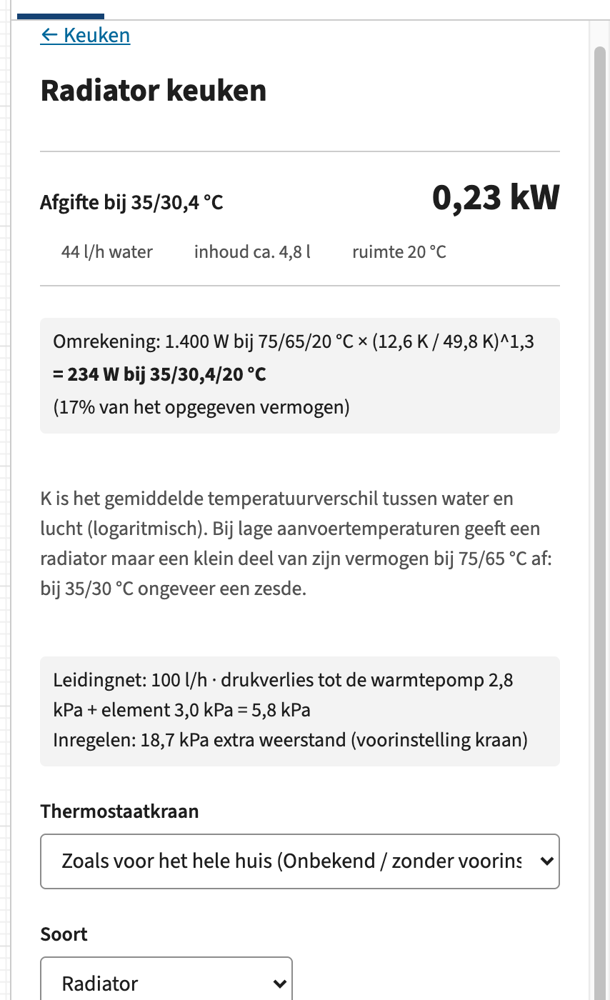

[← Overzicht](../README.md) · Vorige: [Ventilatie en infiltratie](ventilatie.md) · Volgende: [Stooklijn, leidingen en warmtepomp](installatie.md)

# Radiatoren, convectoren en vloerverwarming

## Radiatorvermogen

Klik een radiator aan. De lengte verander je door een uiteinde in de tekening te slepen, of door hem in te vullen bij **Lengte** (mm). Dat werkt ook voor convectoren en fancoils. Onder **Vermogen bepalen** kies je:

- **Zelf invullen**: het vermogen bij 75/65/20 °C van de typeplaat of uit de catalogus. Bij convectoren en fancoils kan alleen dit, want hun vermogen hangt te veel af van de bouwvorm.
- **Een paneeltype** (T10, T11, T20, T21, T22 of T33): vul de hoogte en lengte in mm in. De app schat het vermogen met een vuistregel: het vermogen per meter bij 600 mm hoogte, maal (hoogte / 600)^0,9, maal de lengte. Een T22 van 600 × 1000 mm geeft zo 1700 W. Reken op ongeveer ±10 %. Ken je merk en model, neem dan de waarde uit de tabel van de fabrikant. De hoogte kan tot 3000 mm, ook voor hoge, smalle radiatoren (bijvoorbeeld 1800 × 300 mm). Daar wijkt de vuistregel meer af, dus neem dan liever het vermogen van de fabrikant.

Bij elk element staat hoe de app het vermogen omrekent naar jouw aanvoer- en retourtemperatuur: vermogen × (temperatuurverschil nu / temperatuurverschil bij 75/65/20 °C)^n. Bij 35/30 °C geeft een radiator ongeveer een zesde van zijn vermogen bij 75/65 °C.

## Ventilatoren (boosters)

Zet bij een radiator of convector **Voorzien van ventilatoren (boosters)** aan en kies onder **Hoe rekenen**:

- **Vaste meerafgifte in procenten**: het vermogen zonder ventilatoren × (1 + percentage). Standaard 40 %. Handig als de fabrikant van een losse booster een percentage noemt.
- **Eigen ventilatoren**: voor bijvoorbeeld pc-ventilatoren op PWM. Kies het type (Arctic P8/P9/P12/P14 of Noctua NF-A8/NF-A9/NF-A12x25/NF-A14, in 80, 92, 120 en 140 mm, de dunne Upsiren UL-8015B van 80 mm, of zelf invullen) en vul het aantal en het toerental bij de ontwerptemperatuur in. Bij **Vermogen** blijft het vermogen **zonder** ventilatoren staan.
- **Ingebouwd door de fabrikant (Hybrid, DBE)**: vul het vermogen bij 75/65/20 °C met de ventilatoren aan in, en de exponent n van de fabrikant (bij Jaga ongeveer 1,1). De app telt dan niets extra op.

Bij **Eigen ventilatoren** rekent de app zo:

1. **Lucht**: aantal × luchtdebiet per ventilator × (toerental / maximaal toerental) × 70 % doorlaat door lamellen en rooster.
2. **Lamellenblok**: zonder ventilatoren draagt het blok UA = vermogen / 49,8 K over (W/K). Met ventilatoren is dat ongeveer 5,5 keer zoveel bij 195 m³/h per meter convector, en het schaalt met (lucht / 195 per meter)^0,6. Die verhouding komt uit het selectiemodel van Jaga: de Mini Canal Hybrid tegenover de gewone Mini Canal.
3. **Afgifte**: ε × luchtcapaciteit × (gemiddelde watertemperatuur − ruimtetemperatuur), met ε = 1 − exp(−UA / luchtcapaciteit). De lucht kan nooit warmer worden dan het water, dus meer lucht geeft steeds minder extra.

Onder de berekening staat de afgifte bij 20, 40, 60, 80 en 100 % toerental.

**Benodigd toerental.** Onderaan de kaart rekent de app uit welk toerental de ventilatoren nodig hebben om de ruimte bij de ontwerptemperatuur warm te krijgen. Is de ruimte open verbonden met andere ruimtes, dan geldt dat voor de hele verwarmingszone. Wat andere radiatoren in de ruimte of zone al leveren, gaat eraf. Je ziet het exacte toerental en een advies met 50 % marge, omdat de berekening een schatting is. Met **Zet toerental op …** neem je het advies over. Verander je het aantal of het type ventilatoren, dan rekent het toerental meteen mee. Zo zie je bijvoorbeeld dat 10 ventilatoren op een lager toerental kunnen draaien dan 5. Kunnen de ventilatoren het ook op 100 % niet aan, dan zegt de app hoeveel er ontbreekt.

Een regeling op de watertemperatuur, zoals een HeatMeister, mag dit toerental bijna gelijk houden over de hele stooklijn. De stooklijn verlaagt de aanvoertemperatuur al in dezelfde verhouding als het warmteverlies. Stel het minimale en maximale toerental dus dicht bij elkaar in, rond het advies. Het blijft een schatting. Wil je het precies weten, meet dan aan het water: vermogen = 1,16 × debiet (l/h) × temperatuurverschil aanvoer-retour (K). De ventilatortypen en de ijking staan in [`data/ventilatoren.json`](../data/ventilatoren.json).

## Radiatoradvies

Is de afgifte in een ruimte te klein bij de ingestelde aanvoer- en retourtemperatuur, dan staat bij die ruimte onder *Afgifte* een advies:

- hoeveel vermogen er extra nodig is, gerekend bij 75/65/20 °C zoals het in de catalogus staat;
- **bijplaatsen**: de minimale lengte van een extra paneelradiator (T21, T22, T33) bij 400, 500, 600 en 900 mm hoogte;
- **vervangen**: dezelfde tabel voor één radiator die de hele ruimte verwarmt;
- **boosters**: of ventilatoren onder de bestaande radiator het tekort zouden dekken.

Onder Installatie staat welke ruimtes een tekort hebben. De lengtes komen uit de vuistregel in `data/radiatoren.json` (±10 %). Kies uiteindelijk uit de tabel van de fabrikant.

## Vloerverwarming

Kies **Vloerverw.** (`H`) en klik de hoekpunten. Zo teken je ook een L-vorm. Sluit af door op het eerste punt te klikken, te dubbelklikken of op Enter te drukken. Slepen geeft nog steeds een rechthoek. Moet de hele ruimte vloerverwarming krijgen, klik dan bij de ruimte onder *Afgifte* op **Vloerverwarming in de hele ruimte**. De app tekent die dan op 10 cm van de wanden.

De vorm pas je aan door de vloerverwarming te selecteren:

- sleep een hoekpunt om het te verplaatsen;
- klik op een **+** halverwege een zijde om een hoekpunt toe te voegen;
- dubbelklik op een hoekpunt om het weg te halen.

---

[← Overzicht](../README.md) · Vorige: [Ventilatie en infiltratie](ventilatie.md) · Volgende: [Stooklijn, leidingen en warmtepomp](installatie.md)
