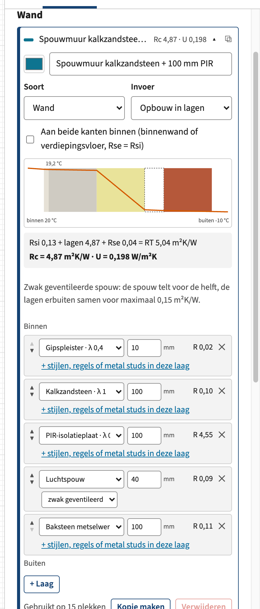

[← Overzicht](../README.md) · Vorige: [Daken, vides en verdiepingen](daken-en-verdiepingen.md) · Volgende: [Ventilatie en infiltratie](ventilatie.md)

# Constructies en isolatiewaarde

De isolatiewaarde leg je vast in een **constructie**, die je daarna aan wanden koppelt. Een constructie gebruik je op zoveel wanden als je wilt. Pas je hem aan, dan verandert de berekening overal mee.

## 1. Constructie maken

Ga naar het tabblad **Constructies** en kies bij *Wand* **+ Wand**. Geef hem een herkenbare naam, bijvoorbeeld "Spouwmuur 1975 na-geïsoleerd", en kies een kleur. Die kleur zie je terug in de tekening.

Bij **Invoer** kies je hoe je de isolatiewaarde opgeeft.

**U-waarde invullen.** Ken je de U-waarde of Rc al, uit een bouwtekening, energielabel, productblad of [ubakus.de](https://www.ubakus.de/u-wert-rechner/), vul hem dan direct in. U en Rc rekenen automatisch in elkaar om. Voor ramen en deuren is dit de gebruikelijke manier. Neem de Uw van het hele raam (glas met kozijn) van de leverancier. Het voorbeeldproject rekent voor HR++ glas in een houten kozijn met U = 1,8.

**Opbouw in lagen.** Weet je waar de muur uit bestaat, bouw hem dan op uit lagen, **van binnen naar buiten**. Voeg per laag een materiaal en de dikte in mm toe. De app rekent per laag R = d / λ uit en telt alles op tot de Rc en de U-waarde. Een spouwmuur ziet er bijvoorbeeld zo uit:

| Laag | Materiaal | Dikte |
|---|---|---|
| 1 | Kalkzandsteen | 100 mm |
| 2 | Isolatie (bijv. PIR-isolatieplaat of glaswol) | 60 mm |
| 3 | Luchtspouw, zwak geventileerd | 40 mm |
| 4 | Baksteen | 100 mm |

Een paar dingen om op te letten:

- **Luchtspouw**: kies of de spouw niet, zwak of sterk geventileerd is. Een gewone spouwmuur met open stootvoegen is meestal *zwak geventileerd*. Bij een sterk geventileerde spouw, zoals achter een geventileerde gevelbekleding, tellen de spouw en alles daarbuiten niet mee. Zo schrijft NEN-EN-ISO 6946 het voor.
- **Stijlen of regels**: zit de isolatie tussen houten stijlen, kies dan bij die laag **+ stijlen, regels of metal studs in deze laag** en vul het aandeel hout in, bijvoorbeeld 10 %. De app rekent dan met het gemiddelde van de boven- en ondergrens.
- **Metal stud (gipswanden)**: bouw de wand op als gipskartonplaat, isolatie en gipskartonplaat. Voeg aan de isolatielaag stijlen toe met het materiaal *Staal (metal stud-profiel)* en een aandeel van ongeveer 0,1 %. Dat hoort bij een profiel van 0,6 mm dik op 600 mm hart-op-hart. Het staal geleidt zo goed dat de Rc daardoor ongeveer een kwart lager uitvalt. Neem de uitkomst als schatting: NEN-EN-ISO 6946 is niet bedoeld voor metaal dat door de isolatie heen loopt.
- **Materialen**: onderaan het tabblad staat de materialenlijst met indicatieve λ-waarden. Pas ze aan of voeg materialen toe. Neem voor isolatie liefst de λD van het productblad.
- **Binnenwanden**: vink *Aan beide kanten binnen* aan. Dan geldt aan beide kanten de binnen-overgangsweerstand.

De doorsnede bovenaan de kaart toont het temperatuurverloop door de wand bij de ontwerptemperatuur. Lagen die niet meetellen worden lichter weergegeven.

## 2. Constructie koppelen aan een wand

Klik in de tekening een wand of wanddeel aan en kies onder **Constructie** de juiste opbouw. Nieuwe ruimtes krijgen standaard de eerste wandconstructie uit de lijst. Loop dus na of elke wand de goede heeft. Ontbreekt er ergens een constructie, dan zie je bij de ruimte *⚠ constructie ontbreekt*.

Onder **Verlies van dit deel** zie je direct wat dit wanddeel aan warmte verliest: oppervlak × (U + ΔU) × temperatuurverschil. Vloer, plafond en dak stel je op dezelfde manier in bij de ruimte zelf, onder *Vloer* en *Dak en plafond*.

---

[← Overzicht](../README.md) · Vorige: [Daken, vides en verdiepingen](daken-en-verdiepingen.md) · Volgende: [Ventilatie en infiltratie](ventilatie.md)
