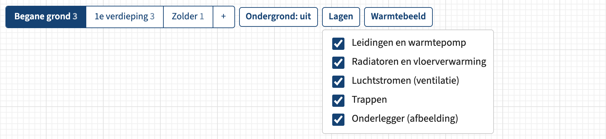
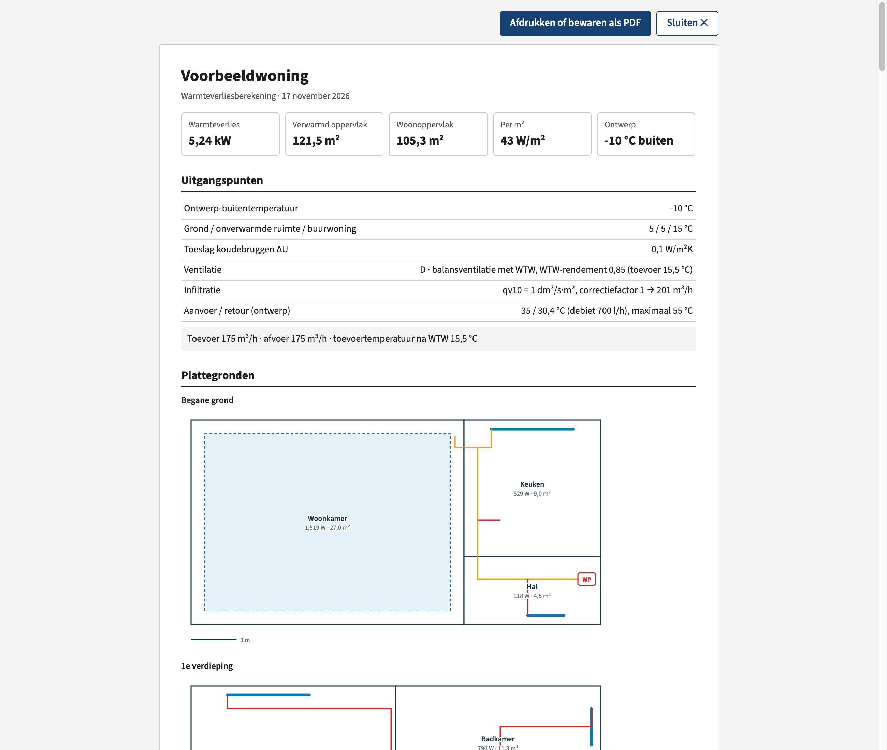

[← Overzicht](../README.md) · Volgende: [Ruimtes en wanden tekenen](tekenen.md)

# Aan de slag

Gebruik de [online versie](https://mellotronscratch.github.io/warmteverlies-tekentafel/), of draai de app op je eigen computer. Installeren hoeft niet, maar je hebt wel een eenvoudige webserver nodig. De app laadt zijn gegevens uit de map `data/`, en browsers laden zulke bestanden niet als je `index.html` direct opent. Bijvoorbeeld:

```sh
cd warmteverlies-tekentafel
python3 -m http.server
```

Open daarna http://localhost:8000. In VS Code kan het ook met de extensie *Live Server*.

De kolom rechts met de eigenschappen maak je breder of smaller door de rand aan de linkerkant te verslepen. Dubbelklik op die rand zet hem terug op de standaardbreedte. Je browser onthoudt de breedte.

Het paneel heeft zes tabbladen:
- **Selectie**: wat je in de tekening hebt aangeklikt.
- **Constructies**: wanden, ramen, vloeren en daken met hun U-waarde.
- **Ventilatie**: ventilatie en infiltratie.
- **Installatie**: afgifte, stooklijn, warmtepomp, systeeminhoud, leidingnet, thermostaatkranen en appendages.
- **Resultaten**: het warmteverlies per ruimte, het woonoppervlak en de verbeteradviezen.
- **Project**: verdiepingen, rekenwaarden en je projecten.

Met **Lagen** boven de tekening zet je leidingen en warmtepomp, radiatoren en vloerverwarming, luchtstromen, trappen en de onderlegger aan of uit. Zo werk je rustiger aan de ruimtes en wanden. Kies je een gereedschap voor iets wat uit staat, zoals *Leiding*, dan komt die laag vanzelf terug.



Met **Ondergrond** kies je welke verdieping lichtgrijs onder de tekening staat, met de omtrek van de ruimtes en de leidingen. Standaard is dat de verdieping eronder, maar je kunt ook een andere kiezen, bijvoorbeeld de zolder terwijl je de 1e verdieping tekent. Je kunt ook de kruipruimte kiezen. De keuze geldt per verdieping en je browser onthoudt hem. Toets `O` zet de ondergrond aan of uit. Op de lijnen van de ondergrond kun je snappen.


Staat iets op de verkeerde verdieping, zoals een leiding, een ruimte of de warmtepomp, kies dan in het paneel bij **Verdieping** de juiste. Radiatoren en vloerverwarming gaan met hun ruimte mee. De warmtepomp kun je ook aanklikken en verslepen.

Met **Rapport (PDF)** bovenaan *Resultaten* maak je een rapport van het hele project. Het bevat de uitgangspunten, de plattegronden per verdieping, het warmteverlies per ruimte met de berekening, de constructies met hun laagopbouw, de afgifte en de stooklijn, het leidingnet met schema en inregeladvies, de verbeteradviezen en de warmtepomp. Bij de warmtepomp staan de gekozen warmtepomp en de geschikte alternatieven, zodat je daar later nog uit kunt kiezen. Kies **Afdrukken of bewaren als PDF** en daarna in het printvenster *Opslaan als PDF*.



Projecten worden in je browser opgeslagen (localStorage). Exporteer regelmatig een `.json` als reservekopie, want bij het wissen van browsergegevens ben je ze kwijt.

---

[← Overzicht](../README.md) · Volgende: [Ruimtes en wanden tekenen](tekenen.md)
