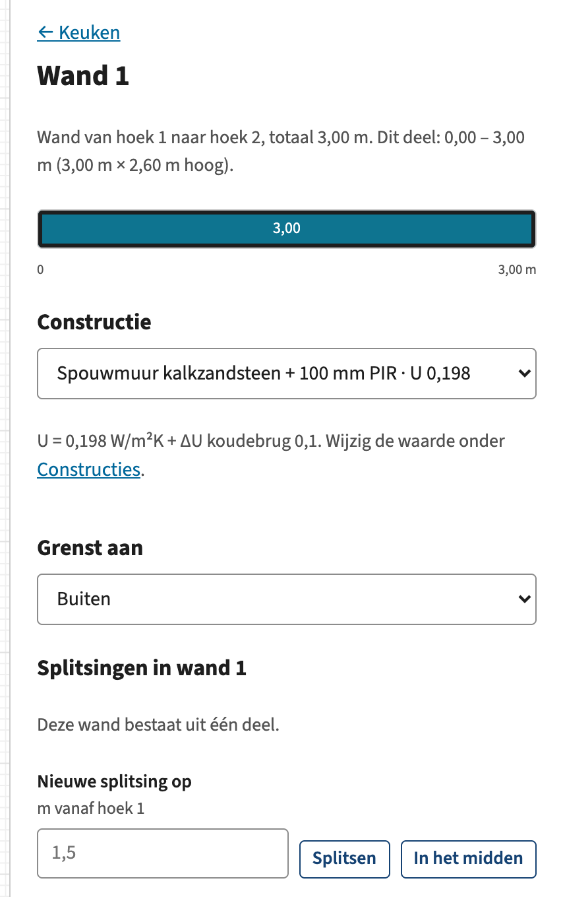

[← Overzicht](../README.md) · Vorige: [Ruimtes en wanden tekenen](tekenen.md) · Volgende: [Daken, vides en verdiepingen](daken-en-verdiepingen.md)

# Wat grenst waaraan

## Wat ligt er achter de wand?

Klik een wand aan om hem te bewerken. Onder **Grenst aan** staat standaard *Automatisch (uit tekening)*: de app kijkt dan in de tekening of er een andere ruimte tegenaan ligt en rekent met de temperatuur van die ruimte. Ligt er niets tegenaan, dan rekent hij met de buitentemperatuur. Je kunt het ook zelf kiezen: buiten, grond / kruipruimte, onverwarmde ruimte, buurwoning of een ruimte met een vaste temperatuur.

## Vloeren en plafonds

Zet bij een ruimte de vloer en het plafond onder **Grenst aan** op *Automatisch (uit tekening)*. Nieuwe ruimtes staan daar standaard al op. De app zoekt dan zelf uit wat eronder en erboven ligt:

- **Vloer**: de ruimtes op de verdieping eronder, met hoeveel m² elk overlapt. Op de laagste verdieping is dat de grond. Een stuk vloer waar niets onder getekend is (bijvoorbeeld een uitkraging) grenst aan buiten.
- **Plafond**: de ruimtes op de verdieping erboven. Is daar niets getekend, dan is het een plat dak naar buiten. Bij een vlak plafond onder een schuin dak is het de onverwarmde ruimte onder de nok.

Per stuk rekent de app met de temperatuur van die ruimte.

**Twee constructies.** Ligt een deel van een plafond onder een ruimte en een ander deel onder buiten, zoals bij een uitbouw, dan kies je bij het plafond ook een **Constructie waar niets boven ligt (dak)**. Het deel onder de zolder rekent dan bijvoorbeeld met een betonvloer, en het platte dak van de uitbouw met houtskeletbouw. Bij de vloer van een verdieping werkt het net zo, voor een stuk waar niets onder ligt (een overstek). Laat je het leeg, dan geldt de eerste constructie voor het hele vlak. Bij de vloer en het plafond zie je de verdeling, bijvoorbeeld *20,3 m² → Slaapkamer 1 (18 °C)*. Een nieuwe ruimte op een verdieping krijgt als vloerconstructie het plafond van de ruimte eronder.

Bestaande projecten houden hun instellingen. Onder **Project → Vloeren en plafonds** zet je alles in één keer op automatisch (ongedaan maken kan).

## Muren naar de buren

Een woningscheidende muur grenst aan de buurwoning. Staat *Grenst aan* op *Automatisch* en is de buurwoning niet getekend, dan rekent de app die muur als buitenmuur. Dat kan het warmteverlies flink te hoog maken. Heeft de constructie *Aan beide kanten binnen* aangevinkt, zoals een binnenwand of woningscheidende muur, en rekent hij toch naar buiten, dan waarschuwt de app: in het startpaneel, bij Resultaten, bij de ruimte en bij het wanddeel. Met **Zet op Buurwoning** zet je die wanddelen in één keer goed. Een wanddeel dat deels tegen een andere ruimte ligt, wordt eerst op de grens gesplitst, zodat alleen het stuk zonder buurruimte op *Buurwoning* komt.

## Gedeelde wanden

Een wand tussen twee ruimtes hoort bij allebei. Kies je voor zo'n wand een andere constructie, dan krijgt het stuk aan de andere kant dezelfde. De app splitst de wand van de buurruimte daarvoor zo nodig op de grens. Het gedeelde stuk licht in de buurruimte gestippeld op.

Grenst een wanddeel aan meer dan één ruimte, of maar voor een deel aan een andere ruimte? Kies dan **Splitsen op de grens**. Dan wordt het gedeelde stuk een apart wanddeel. Een raam of deur die je in een gedeeld wanddeel zet, verschijnt ook in de andere ruimte. Andere maten en verwijderen gaan aan beide kanten mee. Staan de constructies aan beide kanten nog verschillend, bijvoorbeeld in een ouder project, dan kun je ze met **Constructie gelijk trekken** gelijk maken.

## Open verbinding: geen wand tussen twee ruimtes

Soms is de scheiding tussen twee ruimtes geen muur, bijvoorbeeld waar de hal overgaat in de trapvide, of tussen een keuken en een woonkamer zonder tussenwand. Kies dan bij het wanddeel onder **Grenst aan** voor **Open verbinding (geen wand)**. Dan gebeurt er het volgende:

- Dat stuk telt niet mee voor de warmte die van de ene naar de andere ruimte gaat, en het heeft geen constructie nodig.
- De andere ruimte krijgt hier vanzelf ook een open verbinding.
- In de tekening is het een stippellijn, en in de 2,5D-weergave staat er geen muur.
- Hebben de twee ruimtes een andere temperatuur, dan waarschuwt de app. Bij een open verbinding is de temperatuur in de praktijk ongeveer gelijk.
- Lucht stroomt er vrij. Geef onder **Ventilatie** de overstroom op als de ene ruimte lucht toevoert en de andere afzuigt.
- De ruimtes vormen samen één **verwarmingszone** (zie hieronder).

Trek je met **Wand** een nieuwe scheiding, dan kies je in het venster meteen of het een binnenwand of een open verbinding wordt.

**Verwarmingszones.** Ruimtes die open met elkaar verbonden zijn, delen hun warmte. Een grote convector in de woonkamer verwarmt ook de open keuken, en een radiator in de hal ook de trap. Voor de afgifte rekent de app zulke ruimtes daarom samen als één zone, zoals ISSO 51 dat ook toelaat:

- het warmteverlies van alle ruimtes in de zone telt samen tegen de afgifte van alle radiatoren, convectoren en vloerverwarming erin;
- de controle op tekort, de minimaal nodige aanvoertemperatuur, de stooklijn en het radiatoradvies gaan per zone;
- in het leidingnet krijgt elk element zijn deel van het warmteverlies van de hele zone, zodat ook een ruimte zonder eigen radiator meetelt in het debiet;
- bij een ruimte zonder eigen afgifte staat waar hij door verwarmd wordt.

Het warmteverlies per ruimte blijft gewoon per ruimte. Een zone ontstaat alleen als beide kanten van het wanddeel op *Open verbinding* staan. Zit er een deur, teken dan een binnenwand met een deur; dan zijn het aparte ruimtes.

---

[← Overzicht](../README.md) · Vorige: [Ruimtes en wanden tekenen](tekenen.md) · Volgende: [Daken, vides en verdiepingen](daken-en-verdiepingen.md)
