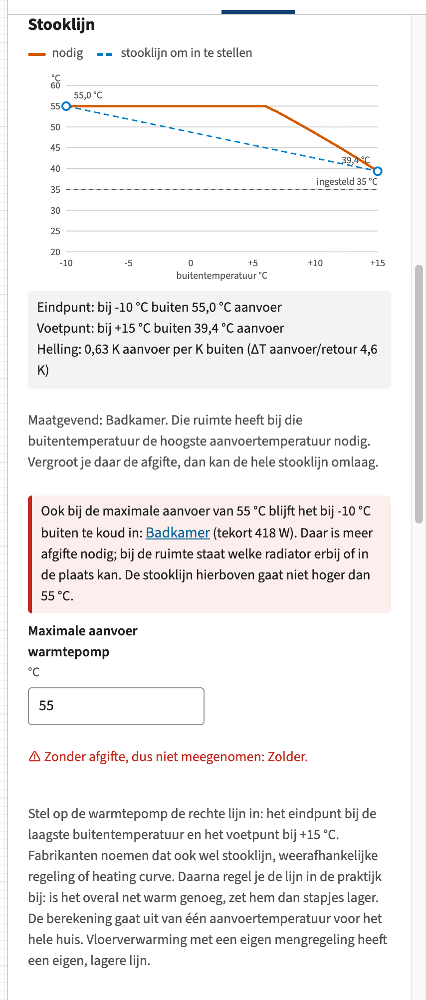
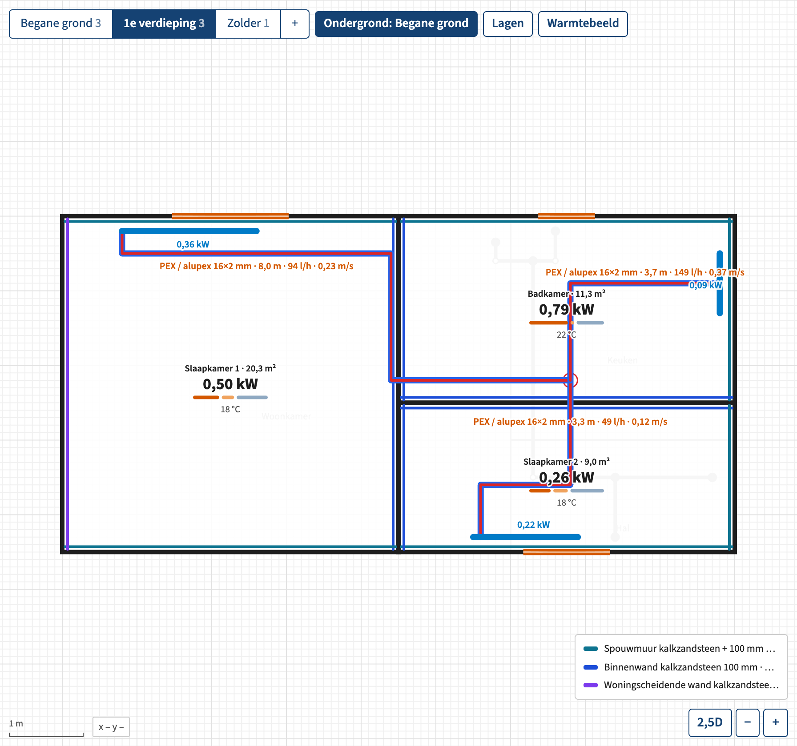

[← Overzicht](../README.md) · Vorige: [Radiatoren, convectoren en vloerverwarming](afgifte.md) · Volgende: [Rekenmethode, woonoppervlak en gegevens](rekenmethode.md)

# Stooklijn, leidingen en warmtepomp

## Stooklijn

Een warmtepomp stelt de aanvoertemperatuur in op de buitentemperatuur: hoe kouder het buiten is, hoe warmer het water. Dat verband heet de **stooklijn** (ook weerafhankelijke regeling of heating curve). Een warmtepomp werkt grofweg 2 à 3 % zuiniger per graad lagere aanvoer, dus een stooklijn die niet hoger staat dan nodig, loont.

Onder **Installatie → Stooklijn** rekent de app voor elke buitentemperatuur van de ontwerptemperatuur tot +15 °C uit welke aanvoertemperatuur nodig is. Het warmteverlies van elke ruimte neemt daarbij evenredig af met het verschil tussen binnen en buiten, en de app zoekt de laagste aanvoer waarbij de radiatoren en de vloerverwarming dat nog dekken. Je ziet:

- de berekende lijn, en de rechte lijn die je op de warmtepomp instelt: het **eindpunt** bij de laagste buitentemperatuur en het **voetpunt** bij +15 °C;
- de helling;
- de **maatgevende ruimte**: de ruimte die de hoogste aanvoer nodig heeft. Vergroot je daar de afgifte, dan kan de hele lijn omlaag.

De berekening gaat uit van één aanvoertemperatuur voor het hele huis, met de ΔT tussen aanvoer en retour uit het project. Stel de lijn daarna in de praktijk bij.

## Debiet van de warmtepomp

Onder **Afgiftesysteem** (bij *Installatie* of bij een radiator) vul je de aanvoertemperatuur in, en óf de retourtemperatuur, óf het **debiet** van de warmtepomp in l/h.

- **Retourtemperatuur ingevuld:** het debiet volgt uit het vermogen: debiet = vermogen / (1,163 × ΔT). Bij een klein huis en ΔT 5 K komt daar vaak een laag debiet uit.
- **Debiet ingevuld** (bijvoorbeeld 700 of 1000 l/h): dan volgt de ΔT uit het vermogen, en daaruit de retourtemperatuur. Een hoger debiet geeft een kleinere ΔT, een hogere gemiddelde watertemperatuur en dus meer afgifte van de radiatoren en convectoren. De stooklijn kan daardoor iets omlaag. Tegelijk stroomt er meer water door de leidingen, dus het drukverlies van het indexcircuit en de stroomsnelheid nemen toe.

Staat bij de gekozen warmtepomp in `data/warmtepompen.json` een `minDebiet`, dan waarschuwt de app als het debiet daaronder ligt. Onder het minimale debiet gaat een warmtepomp pendelen of in storing. Kan het afgiftesysteem het minimale debiet niet aan, dan is een buffervat tussen aanvoer en retour nodig.

## Leidingen en systeeminhoud

Met **Leiding** (`L`) teken je een eenvoudig leidingnetwerk, bijvoorbeeld van de warmtepomp naar de verdeler en de radiatoren. Eén lijn staat voor aanvoer en retour samen. Klik de punten en rond af met dubbelklik of Enter. Per leiding kies je het materiaal (koper, (alu)pex of staal) en de diameter, bijvoorbeeld alupex 32×3 mm. Bij **Extra lengte** vul je stukken in die je niet tekent, zoals een stijgleiding naar een andere verdieping. Je ziet de inhoud van de leiding en hoeveel vermogen hij bij 0,5 m/s kan transporteren.

Onder **Installatie → Systeeminhoud** telt de app de waterinhoud op: getekende leidingen, radiatoren, convectoren, vloerverwarmingslussen, de warmtepomp en eventueel een schakelvat. Dat vergelijkt hij met wat de gekozen warmtepomp nodig heeft:

- staat in de warmtepomplijst een `minInhoud` (liter), dan geldt die;
- anders rekent de app met een vuistregel (standaard 15 liter per kW maximaal vermogen bij +7 °C, aan te passen).

Is de inhoud te klein, dan adviseert de app een schakelvat: dat vergroot de systeeminhoud. Tel in gedachten alleen kringen mee die altijd open staan: thermostaatkranen en ruimteregeling verkleinen de werkelijke inhoud. Een buffervat tussen aanvoer en retour (hydraulische scheiding) is iets anders. Dat heb je nodig als de warmtepomp meer water moet rondpompen dan het afgiftesysteem aankan, of bij extra pompgroepen. Of dat nodig is, volgt uit het debiet (zie [Debiet van de warmtepomp](#debiet-van-de-warmtepomp)), niet uit de inhoud. De waterinhoud van radiatoren is een schatting per meter of per kW. Bij een convector loopt er meestal een lus koperbuis van 15 mm door de lamellen, over de lengte min ongeveer 15 cm. Een lus is twee buizen, en een dubbele convector heeft twee lussen (vier buizen). Kies het aantal lussen bij de convector. Bij elk afgifte-element zie je de geschatte inhoud.

### Leidingnet, debiet en indexcircuit

Plaats met **Warmtepomp** (`K`) de warmtepomp, of de plek waar de leidingen van het buitendeel binnenkomen. Teken daarna met **Leiding** de leidingen vanaf dat punt. De app maakt er een netwerk van:

- **Vastklikken**: een leiding klikt vast op de warmtepomp, op de uiteinden van radiatoren en convectoren, op de hoeken van vloerverwarming en op andere leidingen. Eindigt een leiding óp een andere leiding, dan is dat een T-stuk.
- **Stijgleidingen**: laat een leiding op twee verdiepingen op precies hetzelfde punt eindigen. Met *Ondergrond* op de verdieping eronder zie je de leidingen daarvan lichtgrijs, met hun punten als stip. Met het gereedschap Leiding zie je ook die van de verdieping erboven, gestippeld. Klik op zo'n punt (de cirkel toont dan *stijgleiding*), dan worden de leidingen verticaal verbonden (↕). De lengte volgt uit het hoogteverschil tussen de verdiepingen.
- **Aangesloten**: een radiator of vloerverwarming hangt aan het leidingnet als er binnen 30 cm een leidingpunt ligt. Geen leiding betekent geen verbinding.
- **Aansluitleiding**: die vul je niet apart in. De app neemt de getekende leiding waar het element aan hangt, en controleert met de maat daarvan de stroomsnelheid. Een andere maat kies je bij de leiding zelf. In het paneel van het element klik je door naar die leiding.

Vanaf de warmtepomp rekent de app per leidingstuk het debiet (de som van alles erachter), de stroomsnelheid en het drukverlies (Darcy-Weisbach, aanvoer + retour, met een instelbare opslag voor bochten en koppelingen). Het debiet per element is zijn aandeel in het warmteverlies van de ruimte, bij de ΔT tussen aanvoer en retour.

Het **indexcircuit** is de route naar het element met het grootste totale drukverlies: leidingen plus het element zelf. Het licht oranje op in de plattegrond. Leidingen die te klein zijn, lichten paars op: fel boven 0,8 m/s (*te klein*), lichter tussen 0,5 en 0,8 m/s (*krap*). Ga met de muis over zo'n stuk om de snelheid te zien. De legenda rechtsonder legt de kleuren uit. Onder **Installatie → Leidingnet en indexcircuit** zie je:

- per element het debiet, het drukverlies en hoeveel extra weerstand het nodig heeft om goed ingeregeld te zijn ten opzichte van het indexcircuit;
- leidingstukken waar het water sneller stroomt dan 0,5 m/s;
- elementen die niet zijn aangesloten, en lussen in het net.

Met **Schema van het leidingnet** (onder Installatie of bij de warmtepomp) zie je het hele circuit als schema: van de warmtepomp naar alle aangesloten elementen. Rechte stukken zonder aftakking zijn samengevoegd. Per stuk zie je de maat, de lengte, het debiet, de snelheid en waar een stijgleiding naar een andere verdieping gaat. Per element zie je het vermogen, het debiet, het drukverlies en het inregeladvies. Het indexcircuit is oranje. Een leiding die nergens heen gaat, staat er als *loos eind* in. Klik op een element om het te openen, of druk het schema af.

In een gesloten cv-systeem hoeft de pomp het water niet omhoog te pompen. Hij moet alleen de weerstand overwinnen, en dat is het drukverlies van het indexcircuit. Zet je bij een warmtepomp in `data/warmtepompen.json` de `restopvoerhoogte` (kPa), dan vergelijkt de app die ermee.

Zonder gekozen thermostaatkraan is de weerstand van een element indicatief: 3 kPa voor een radiator of convector met kraan, 10 kPa voor een fancoil. Vloerverwarming rekent de lussen van 16×2 mm, verdeeld over groepen van hoogstens 100 m, plus 2 kPa voor de verdeler.

### Thermostaatkranen en voorinstelling

Onder **Installatie → Thermostaatkranen** kies je welke kranen er in het huis zitten. Heeft één radiator een andere kraan, kies die dan in het paneel van die radiator. De app rekent dan de voorinstelling per radiator uit:

- **Kranen met standen**, zoals Heimeier V-exact II (1–8) of Danfoss RA-N (1–7 en N): de kraan van het indexcircuit staat helemaal open. Voor elke andere radiator zoekt de app de stand waarmee hij zijn ontwerpdebiet krijgt, met de kv-waarden per stand uit de datasheet. Bij de radiator staat hoeveel procent van het ontwerpdebiet die stand ongeveer geeft. Laat zelfs stand 1 te veel water door, dan zegt de app dat.
- **Heimeier Eclipse**: die begrenst zelf het debiet. Je stelt per radiator het debiet in l/h in. De kraan heeft wel minstens 10 kPa drukverschil nodig (15 kPa boven 100 l/h), en dat telt mee in het indexcircuit.

De standen staan in de tabel onder **Leidingnet en indexcircuit**, in het schema en in het rapport. Andere kranen voeg je toe in `data/thermostaatkranen.json`.

### Inregelstaat

Met **Inregelstaat (afdrukken)** onder *Leidingnet en indexcircuit* maak je één overzicht om mee langs de radiatoren te lopen: per verdieping en ruimte de kraan, wat je instelt (de stand, of het debiet bij een debietbegrenzer en bij vloerverwarming per groep), het debiet, het vermogen en een vakje om af te vinken. Bovenaan staan de aanvoer- en retourtemperatuur, het totale debiet en wat de pomp moet leveren, met de stappen:

1. Warmtepomp op de aanvoertemperatuur (en het debiet) zetten.
2. Thermostaatkoppen eraf, alle kranen open.
3. Per element de voorinstelling instellen; de kraan van het indexcircuit blijft open.
4. Koppen terug.
5. Na een paar dagen de retourleidingen voelen of meten: is een retour warmer dan de berekende retourtemperatuur, dan krijgt dat element te veel water.

Vraagt een element meer dan zijn kraan kan doorlaten, of is de kleinste stand nog te ruim, dan staat dat in rood bij dat element. Kies **Afdrukken of bewaren als PDF** om hem op papier of als PDF te bewaren.

### Appendages bij de warmtepomp

Onder **Installatie → Appendages bij de warmtepomp** zet je de onderdelen in de hoofdleiding waar al het water doorheen gaat: een vuil- of magneetfilter, afsluiters, een terugslagklep, de driewegklep voor tapwater, een warmtemeter of een platenwisselaar. Hun drukverlies is (debiet ÷ kv)² en telt op bij het indexcircuit. Dat totaal vergelijkt de app met de restopvoerhoogte van de warmtepomp. De voorgestelde kv is een typische waarde voor 1 inch; vul liever de kv uit de datasheet van jouw onderdeel in.

## Warmtepomp kiezen

Onder **Installatie → Warmtepomp** vergelijk je de warmtepompen uit `data/warmtepompen.json` met het warmteverlies van je huis. De grafiek toont het warmteverlies over de buitentemperatuur, met het maximale en minimale vermogen van de gekozen warmtepomp. Een geschikte warmtepomp dekt bij de ontwerptemperatuur het verlies, en kan bij +10 °C ver genoeg terugregelen zodat hij niet steeds aan- en afslaat (pendelen). Per warmtepomp zie je vanaf welke buitentemperatuur hij pendelt.

## Jaarverbruik en kosten

Onder de warmtepompkeuze schat **Jaarverbruik en kosten** wat je huis in een gemiddeld jaar aan warmte vraagt, hoeveel stroom de gekozen warmtepomp daarvoor gebruikt, en wat dat kost tegenover een cv-ketel op gas.

- **Warmtevraag**: per buitentemperatuur het warmteverlies (de lijn uit de warmtepompkeuze, met de aangevinkte verbeteradviezen) min de warmte van mensen, apparaten en zon. Die winst is gelijk aan het verlies bij de **stookgrens**: boven die buitentemperatuur stookt het huis niet. In een goed geïsoleerd huis ligt de stookgrens rond 13–15 °C, in een oud huis rond 16–18 °C.
- **Klimaat**: het aantal uren per jaar bij elke buitentemperatuur in De Bilt, gemiddeld over 2011–2025 (KNMI).
- **COP**: uit het verschil tussen de aanvoertemperatuur van de stooklijn en de buitenlucht. Zonder gegevens van de fabrikant rekent de app met een gemiddelde lijn voor lucht/water-warmtepompen (Staffell e.a., 2012, inclusief ontdooien). Staan er COP-waarden bij de warmtepomp in `data/warmtepompen.json` (`cop`), dan schaalt de app die lijn daarnaar.
- **Te klein of te groot**: wat boven het maximale vermogen uitkomt, levert een elektrisch element. Ligt de vraag onder het minimale vermogen, dan pendelt de warmtepomp; die uren staan erbij, en ze kosten ongeveer 10% rendement.

Je ziet de warmtevraag in kWh en in m³ gas, het stroomverbruik, het seizoensrendement (SCOP), de gemiddelde aanvoertemperatuur en de kosten, met een uitsplitsing per temperatuurbereik. Vul de stroom- en gasprijs van je eigen contract in, en bij *Vaste kosten gas* wat je bespaart als de gasaansluiting eruit gaat. Kies je bij *Netbeheerder gas* je netbeheerder, dan vult de app daar de netbeheerkosten voor gas in: aansluiting, vastrecht, meterhuur en capaciteit, inclusief btw, voor een gewone huisaansluiting met 500 tot 4.000 m³ per jaar. Tel daar zelf de vaste leveringskosten van je energieleverancier bij op; die staan op je energierekening. De bedragen staan in [`data/netbeheer.json`](../data/netbeheer.json) en gelden voor 2026.

Staat de stooklijn op de koudste dagen op het maximum omdat een ruimte te weinig afgifte heeft, dan zegt de app dat: een hoge aanvoertemperatuur kost rendement, en meer afgifte verlaagt de stroomrekening. Warm tapwater, nachtverlaging en je eigen stookgedrag zitten niet in de schatting. Het jaarverbruik staat ook in het rapport.

---

[← Overzicht](../README.md) · Vorige: [Radiatoren, convectoren en vloerverwarming](afgifte.md) · Volgende: [Rekenmethode, woonoppervlak en gegevens](rekenmethode.md)
