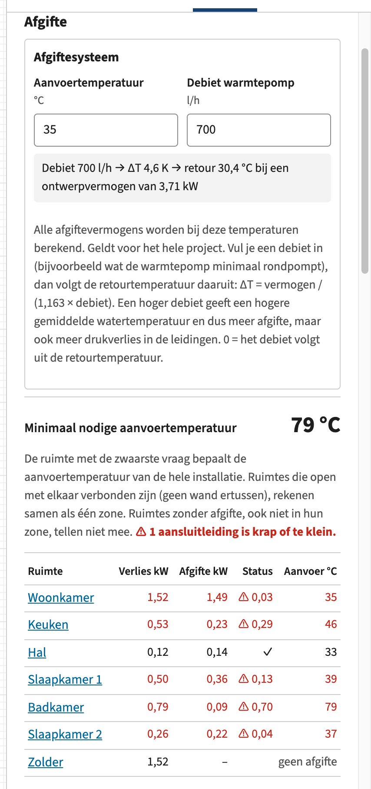
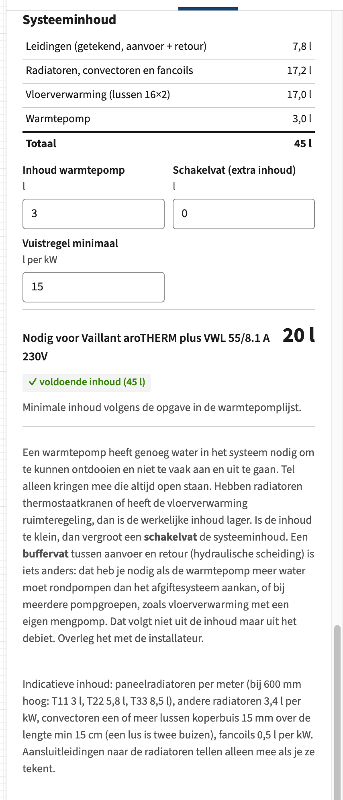
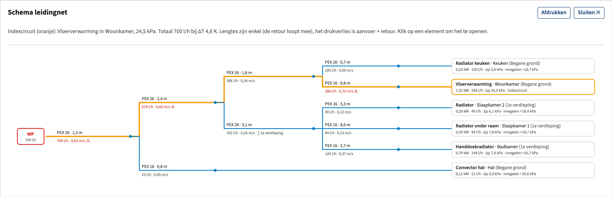
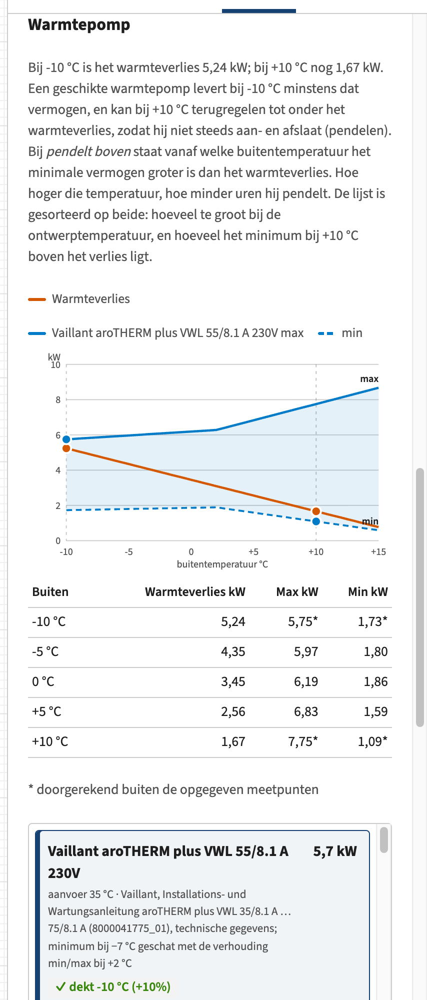

[← Overzicht](../README.md) · Vorige: [Radiatoren, convectoren en vloerverwarming](afgifte.md) · Volgende: [Rekenmethode, woonoppervlak en gegevens](rekenmethode.md)

# Stooklijn, leidingen en warmtepomp

## Stooklijn

Een warmtepomp stelt de aanvoertemperatuur in op de buitentemperatuur: hoe kouder het buiten is, hoe warmer het water. Dat verband heet de **stooklijn** (ook weerafhankelijke regeling of heating curve). Een warmtepomp werkt grofweg 2 à 3 % zuiniger per graad lagere aanvoer, dus een stooklijn die niet hoger staat dan nodig, loont.

Onder **Warmtepomp → Stooklijn** rekent de app voor elke buitentemperatuur van de ontwerptemperatuur tot +15 °C uit welke aanvoertemperatuur nodig is. Het warmteverlies van elke ruimte neemt daarbij evenredig af met het verschil tussen binnen en buiten, en de app zoekt de laagste aanvoer waarbij de radiatoren en de vloerverwarming dat nog dekken. Je ziet:

- de berekende lijn, en de rechte lijn die je op de warmtepomp instelt: het **eindpunt** bij de laagste buitentemperatuur en het **voetpunt** bij +15 °C;
- de helling;
- de **maatgevende ruimte**: de ruimte die de hoogste aanvoer nodig heeft. Vergroot je daar de afgifte, dan kan de hele lijn omlaag.

De berekening gaat uit van één aanvoertemperatuur voor het hele huis, met de ΔT tussen aanvoer en retour uit het project. Stel de lijn daarna in de praktijk bij.

Stel je de stooklijn op je warmtepomp of regeling in met losse punten, gebruik dan **Stooklijn in punten**. Vul bij **Aantal punten** in hoeveel punten jouw regeling heeft (2 tot 10); er verschijnt dan voor elk punt een vakje. Vul daarin de buitentemperaturen in, bijvoorbeeld −15, −10, 0, 5, 10 en 15 °C. Een nieuw vakje begint 5 graden boven het vorige. Een leeg vakje telt niet mee. De tabel eronder geeft per punt de nodige aanvoertemperatuur, naar boven afgerond op een halve graad, en de maatgevende ruimte. Die waarden neem je zo over. Een punt onder de ontwerptemperatuur rekent de app door: het warmteverlies loopt daar in een rechte lijn verder op.

Onder **Installatie → Afgifte** staat per ruimte het warmteverlies, de afgifte en in de kolom **Nodig °C** hoe warm het water minimaal moet zijn om die ruimte warm te krijgen. Alle radiatoren, convectoren en vloerverwarming krijgen hetzelfde water van de warmtepomp; het is dus geen temperatuur per radiator. De ruimte met de hoogste waarde is *maatgevend* en bepaalt de aanvoertemperatuur. Een ruimte met een lager getal heeft afgifte over: daar knijpt de thermostaatkraan wat dicht.

## Debiet van de warmtepomp

Onder **Afgiftesysteem** (bij *Installatie* of bij een radiator) vul je de aanvoertemperatuur in, en óf de retourtemperatuur, óf het **debiet** van de warmtepomp in l/h.

- **Retourtemperatuur ingevuld:** het debiet volgt uit het vermogen: debiet = vermogen / (1,163 × ΔT). Bij een klein huis en ΔT 5 K komt daar vaak een laag debiet uit.
- **Debiet ingevuld** (bijvoorbeeld 700 of 1000 l/h): dan volgt de ΔT uit het vermogen, en daaruit de retourtemperatuur. Een hoger debiet geeft een kleinere ΔT, een hogere gemiddelde watertemperatuur en dus meer afgifte van de radiatoren en convectoren. De stooklijn kan daardoor iets omlaag. Tegelijk stroomt er meer water door de leidingen, dus het drukverlies van het indexcircuit en de stroomsnelheid nemen toe.

Staat bij de gekozen warmtepomp in de lijst een minimaal debiet, dan waarschuwt de app als het debiet daaronder ligt. Onder het minimale debiet gaat een warmtepomp pendelen of in storing. Kan het afgiftesysteem het minimale debiet niet aan, dan is een buffervat tussen aanvoer en retour nodig.

## Leidingen en systeeminhoud

Met **Leiding** (`L`) teken je een eenvoudig leidingnetwerk, bijvoorbeeld van de warmtepomp naar de verdeler en de radiatoren. Eén lijn staat voor aanvoer en retour samen. Klik de punten en rond af met dubbelklik of Enter. Per leiding kies je het materiaal (koper, (alu)pex of staal) en de diameter, bijvoorbeeld alupex 32×3 mm. Bij **Extra lengte** vul je stukken in die je niet tekent. Bij **Hoogte** kies je of de leiding langs de vloer loopt, in de vloer (bijvoorbeeld in een mantelbuis in het beton gestort), langs het plafond (bijvoorbeeld op de zolder of onder een verlaagd plafond), in het plafond (de vloer van de verdieping erboven) of op een eigen hoogte boven de vloer. Een leiding in de vloer of in het plafond telt meteen als weggewerkt. Loopt een leiding hoger, dan telt het stuk omlaag naar een radiator, convector, vloerverwarming of de warmtepomp mee in de lengte, en ook bij een stijgleiding telt de echte hoogte. Je ziet de inhoud van de leiding en hoeveel vermogen hij kan transporteren zonder waarschuwing.

Vink **Weggewerkt** aan bij een leiding die in de vloer, een muur, een koof of de kruipruimte zit. Stromingsgeluid hoor je alleen bij een leiding die in het zicht loopt. Daarom gelden twee grenzen:

| Snelheid | Zichtbare leiding | Weggewerkte leiding |
| --- | --- | --- |
| tot 0,5 m/s | goed | goed |
| 0,5 tot 0,8 m/s | *stromingsgeluid* | goed |
| boven 0,8 m/s | *te klein*: geluid en veel drukverlies | *te klein*: veel drukverlies, geluid hoor je niet |

Boven 0,8 m/s loopt het drukverlies snel op, ook als je de leiding niet hoort: de pomp moet harder werken en elementen verderop krijgen minder water. Een weggewerkte leiding is in de tekening gestreept.

Onder **Warmtepomp → Systeeminhoud** telt de app de waterinhoud op: getekende leidingen, radiatoren, convectoren, vloerverwarmingslussen, de warmtepomp en eventueel een schakelvat. Dat vergelijkt hij met wat de gekozen warmtepomp nodig heeft:

- staat in de warmtepomplijst een `minInhoud` (liter), dan geldt die;
- anders rekent de app met een vuistregel (standaard 15 liter per kW maximaal vermogen bij +7 °C, aan te passen).

Is de inhoud te klein, dan adviseert de app een schakelvat: dat vergroot de systeeminhoud. Tel in gedachten alleen kringen mee die altijd open staan: thermostaatkranen en ruimteregeling verkleinen de werkelijke inhoud. Een buffervat tussen aanvoer en retour (hydraulische scheiding) is iets anders. Dat heb je nodig als de warmtepomp meer water moet rondpompen dan het afgiftesysteem aankan, of bij extra pompgroepen. Of dat nodig is, volgt uit het debiet (zie [Debiet van de warmtepomp](#debiet-van-de-warmtepomp)), niet uit de inhoud. De waterinhoud van radiatoren is een schatting per meter, per lid (kolomradiatoren) of per kW. Bij een convector loopt er meestal een lus koperbuis van 15 mm door de lamellen, over de lengte min ongeveer 15 cm. Een lus is twee buizen, en een dubbele convector heeft twee lussen (vier buizen). Kies het aantal lussen bij de convector. Bij elk afgifte-element zie je de geschatte inhoud.

### Leidingnet, debiet en indexcircuit

Plaats met **Warmtepomp** (`K`) de warmtepomp, of de plek waar de leidingen van het buitendeel binnenkomen. Teken daarna met **Leiding** de leidingen vanaf dat punt. De app maakt er een netwerk van:

- **Vastklikken**: een leiding klikt vast op de warmtepomp, op radiatoren en convectoren (op de uiteinden, maar ook ergens in het midden, bijvoorbeeld bij een middenaansluiting), op de hoeken van vloerverwarming en op andere leidingen. Eindigt een leiding óp een andere leiding, dan is dat een T-stuk.
- **Stijgleidingen**: een stijgleiding is een verticale leiding op één plek, van de ene verdieping naar de andere. Je maakt er een met de knop **Stijgleiding bij het beginpunt** of **bij het eindpunt** bij een leiding, of door een leiding te laten beginnen of eindigen op het punt van een leiding op de verdieping erboven of eronder. Met *Ondergrond* op de verdieping eronder zie je de leidingen daarvan lichtgrijs, met hun punten als stip. Met het gereedschap Leiding zie je ook die van de verdieping erboven, gestippeld. Op elke verdieping waar de stijgleiding langskomt staat een rondje met een pijl (↑ waar hij begint, ↓ waar hij eindigt, ↕ ertussen). Teken op de andere verdieping een leiding vanaf dat rondje: hij klikt er vanzelf op vast. Een leiding die tot op een paar centimeter bij de stijgleiding komt, of er langs loopt, is ook aangesloten.
- **Stijgleiding aanpassen**: klik op het rondje. Je kiest de naam, van welke tot en met welke verdieping hij loopt (ook over meer verdiepingen, bijvoorbeeld van de begane grond naar de zolder), het materiaal, de diameter en of hij weggewerkt is. Je ziet de lengte, de inhoud, het debiet en op welke verdiepingen nog geen leiding aansluit. Sleep het rondje om de stijgleiding te verplaatsen: de leidingpunten erop gaan mee. Het rondje klikt vast op radiatoren, leidingen en de warmtepomp. Gaat een stijgleiding recht door de vloer naar een radiator, sleep hem dan op de aansluiting van de radiator: een leidingstuk ertussen is niet nodig. Bij een leiding staat ook welke stijgleiding aan het begin- of eindpunt zit; klik erop om er heen te gaan.
- **Aangesloten**: een radiator of vloerverwarming hangt aan het leidingnet als er binnen 30 cm een leidingpunt ligt. Geen leiding betekent geen verbinding. Laat je een leiding óp een radiator eindigen, dan hoort de radiator bij die leiding: hij hangt dan niet aan een andere leiding die toevallig ook in de buurt ligt.
- **Aansluitleiding**: die vul je niet apart in. De app neemt de getekende leiding waar het element aan hangt, en controleert met de maat daarvan de stroomsnelheid. Een andere maat kies je bij de leiding zelf. In het paneel van het element klik je door naar die leiding.

Vanaf de warmtepomp rekent de app per leidingstuk het debiet (de som van alles erachter), de stroomsnelheid en het drukverlies (Darcy-Weisbach, aanvoer + retour, met een instelbare opslag voor bochten en koppelingen). Het debiet per element is zijn aandeel in het warmteverlies van de ruimte, bij de ΔT tussen aanvoer en retour.

Het **indexcircuit** is de route naar het element met het grootste totale drukverlies: leidingen plus het element zelf. Het licht oranje op in de plattegrond. Leidingen die te klein zijn, lichten paars op: fel boven 0,8 m/s (*te klein*), lichter tussen 0,5 en 0,8 m/s in een zichtbare leiding (*stromingsgeluid*). Ga met de muis over zo'n stuk om de snelheid te zien. De legenda rechtsonder legt de kleuren uit. Onder **Installatie → Leidingnet en indexcircuit** zie je:

- per element het debiet, het drukverlies en hoeveel extra weerstand het nodig heeft om goed ingeregeld te zijn ten opzichte van het indexcircuit;
- leidingstukken die te klein zijn (boven 0,8 m/s), en zichtbare leidingstukken met stromingsgeluid (0,5 tot 0,8 m/s);
- elementen die niet zijn aangesloten, en lussen in het net.

Met **Schema van het leidingnet** (onder Installatie of bij de warmtepomp) zie je het hele circuit als schema: van de warmtepomp naar alle aangesloten elementen. Rechte stukken zonder aftakking zijn samengevoegd. Per stuk zie je de maat, de lengte, het debiet, de snelheid en waar een stijgleiding naar een andere verdieping gaat. Per element zie je het vermogen, het debiet, het drukverlies en het inregeladvies. Het indexcircuit is oranje. Een leiding die nergens heen gaat, staat er als *loos eind* in. Klik op een element om het te openen, of druk het schema af.

In een gesloten cv-systeem hoeft de pomp het water niet omhoog te pompen. Hij moet alleen de weerstand overwinnen, en dat is het drukverlies van het indexcircuit. Staat bij de warmtepomp in de lijst de restopvoerhoogte (kPa), dan vergelijkt de app die ermee.

Zonder gekozen thermostaatkraan is de weerstand van een element indicatief: 3 kPa voor een radiator of convector met kraan, 10 kPa voor een fancoil. Vloerverwarming rekent de lussen van 16×2 mm, verdeeld over groepen van hoogstens 100 m, plus 2 kPa voor de verdeler.

### Thermostaatkranen en voorinstelling

Onder **Installatie → Thermostaatkranen** kies je welke kranen er in het huis zitten. Heeft één radiator een andere kraan, kies die dan in het paneel van die radiator. De app rekent dan de voorinstelling per radiator uit:

- **Kranen met standen**, zoals Heimeier V-exact II (1–8), Danfoss RA-N (1–7 en N) of Oventrop AV 9 (1–9) en AV 6 (1–6): de kraan van het indexcircuit staat helemaal open. Voor elke andere radiator zoekt de app de stand waarmee hij zijn ontwerpdebiet krijgt, met de kv-waarden per stand uit de datasheet. Bij de radiator staat hoeveel procent van het ontwerpdebiet die stand ongeveer geeft. Laat zelfs stand 1 te veel water door, dan zegt de app dat.
- **Debietbegrenzers**: die begrenzen zelf het debiet. Je stelt per radiator het debiet in l/h in. Ze hebben wel een minimaal drukverschil nodig, en dat telt mee in het indexcircuit:

  | Kraan | Instelbereik | Minimaal drukverschil |
  | --- | --- | --- |
  | Heimeier Eclipse | 10–150 l/h | 10 kPa (15 kPa boven 100 l/h) |
  | Heimeier Eclipse 300 | 30–300 l/h | 20 kPa |
  | Jaga Gampper Vario DP (opvolger van de Eclipse bij Jaga) | 20–340 l/h | 15 kPa |
  | Danfoss RA-DV | standen 1–7 en N: 10–135 l/h | 10 kPa |
  | Oventrop AQ | 10–170 l/h | 10 kPa (15 kPa boven 130 l/h) |
  | Oventrop AQH | 35–420 l/h | 15 kPa (20 kPa boven 170, 25 kPa boven 300 l/h) |
  | Caleffi Dynamical | standen 1–6: 20–120 l/h | 10 kPa (15 kPa bij stand 5 en 6) |

- **Handkranen** (*Handkraan (geen thermostaatkraan)*): gewone radiatorkranen zonder thermostaat en zonder voorinstelling. Bij een warmtepomp werkt dat goed: de kranen staan helemaal open en de stooklijn regelt de temperatuur. Alleen kranen open zetten is niet genoeg: dan krijgt de radiator met de kortste route het meeste water en de radiator met de hoogste weerstand te weinig. Je regelt de verdeling daarom met de **voetventielen**, aan de andere kant van de radiator. Per radiator staat bij *Inregelen* hoeveel extra weerstand het voetventiel moet geven, in kPa en als kv-waarde; hoeveel slagen dicht dat is, staat in de datasheet van het voetventiel. Het voetventiel van het indexcircuit blijft open. De app rekent een open handkraan met kv 1,5.

  Draai een handkraan liever niet helemaal dicht. In een koude kamer slaat vocht neer op muren en ramen, en als veel kranen dicht staan, krijgt de warmtepomp te weinig water en gaat hij pendelen. Wil je een kamer koeler, draai de kraan dan een stukje dicht en zet de kamer in de app op die lagere temperatuur. Thermostaatkranen met een voorinstelling of debietbegrenzers maken inregelen makkelijker en regelen per kamer op zon en andere warmte, maar nodig zijn ze niet.

  Bij een kraan met vaste standen, zoals de Danfoss RA-DV en de Caleffi Dynamical, kiest de app de kleinste stand die genoeg doorlaat.

  Vraagt een radiator meer dan de kraan doorlaat, dan zegt de app dat. Bij een convector die meer dan 150 l/h nodig heeft, is een Eclipse 300 of Gampper Vario DP dus de oplossing.

De standen staan in de tabel onder **Leidingnet en indexcircuit**, in het schema en in het rapport. Staat jouw kraan er niet bij? [Meld hem](../README.md#fouten-suggesties-en-bijdragen) met de datasheet van de fabrikant.

### Inregelstaat

Met **Inregelstaat (afdrukken)** onder *Leidingnet en indexcircuit* maak je één overzicht om mee langs de radiatoren te lopen: per verdieping en ruimte de kraan, wat je instelt (de stand, het debiet bij een debietbegrenzer en bij vloerverwarming per groep, of de kv van het voetventiel bij een handkraan), het debiet, het vermogen en een vakje om af te vinken. Bovenaan staan de aanvoer- en retourtemperatuur, het totale debiet en wat de pomp moet leveren, met de stappen:

1. Warmtepomp op de aanvoertemperatuur (en het debiet) zetten.
2. Thermostaatkoppen eraf, alle kranen open.
3. Per element de voorinstelling instellen; de kraan van het indexcircuit blijft open.
4. Koppen terug.
5. Na een paar dagen de retourleidingen voelen of meten: is een retour warmer dan de berekende retourtemperatuur, dan krijgt dat element te veel water.

Bij handkranen zijn de stappen: alle handkranen en voetventielen open, per radiator het voetventiel dichtknijpen tot de kv-waarde uit de tabel (dat van het indexcircuit blijft open), de handkranen open laten, en na een paar dagen de retourtemperatuur controleren.

Vraagt een element meer dan zijn kraan kan doorlaten, of is de kleinste stand nog te ruim, dan staat dat in rood bij dat element. Kies **Afdrukken of bewaren als PDF** om hem op papier of als PDF te bewaren.

### Appendages bij de warmtepomp

Onder **Installatie → Appendages bij de warmtepomp** zet je de onderdelen in de hoofdleiding waar al het water doorheen gaat: een vuil- of magneetfilter, afsluiters, een terugslagklep, de driewegklep voor tapwater, een warmtemeter of een platenwisselaar. Hun drukverlies is (debiet ÷ kv)² en telt op bij het indexcircuit. Dat totaal vergelijkt de app met de restopvoerhoogte van de warmtepomp. De voorgestelde kv is een typische waarde voor 1 inch; vul liever de kv uit de datasheet van jouw onderdeel in.

## Warm tapwater

Onder **Warmtepomp → Warm tapwater** geef je aan of de warmtepomp ook het warme tapwater maakt, met een boiler. Dat staat standaard aan. Zet het uit bij een hybride warmtepomp, waarbij de cv-ketel het tapwater maakt, of bij een losse elektrische boiler.

- **Onderbreking**: terwijl de warmtepomp de boiler opwarmt, verwarmt hij het huis niet. Hoe lang dat op een koude dag duurt, rekent de app uit: de warmte voor tapwater per dag (bewoners plus warmhoudverlies) gedeeld door wat de warmtepomp bij de ontwerptemperatuur voor tapwater levert. Dat is zijn vermogen bij 55 °C aanvoer als dat in de lijst staat, en anders 80% van zijn gewone vermogen. Elke warmtepomp in de lijst krijgt zo zijn eigen tijd: een grotere is sneller klaar. Bij de **inhoud van de boiler** staat ook hoe lang het duurt om de hele boiler op te warmen. De spiraal in de boiler kan het langzamer maken; die rekent de app niet mee. Weet je hoe lang het bij jou duurt, vul dan zelf het aantal uren in; een leeg vakje rekent weer automatisch. In de overige uren moet de warmtepomp het inhalen. Met 1,5 uur per dag is bij de ontwerptemperatuur 24 / 22,5 = 7% meer vermogen nodig. De warmtepompkeuze rekent daarmee, en de grafiek toont het als gestreepte lijn *met tapwater*. In het jaarverbruik heeft de warmtepomp per dag minder uren voor verwarming.
- **Energie**: de warmte voor tapwater per bewoner (standaard 800 kWh per jaar, met het leidingverlies) plus het **warmhoudverlies** van de boiler in watt, zoals op het energielabel of in de datasheet staat (standaard 50 W). Die waarde is gemeten met de boiler op 65 °C in een ruimte van 20 °C; de app rekent hem om naar jouw boilertemperatuur. Een boiler op 50 °C verliest zo twee derde van de labelwaarde. De COP volgt uit de boilertemperatuur plus 5 K tegen de buitenlucht, over alle uren van het jaar, ook in de zomer.
- **Gas**: in de vergelijking maakt een combiketel het tapwater, zonder boiler en met een lager rendement dan voor verwarming (standaard 75%).

## Warmtepomp kiezen

Onder **Warmtepomp → Warmtepomp kiezen** vergelijk je de warmtepompen uit de lijst van de app met het warmteverlies van je huis. De grafiek toont het warmteverlies over de buitentemperatuur, met het maximale en minimale vermogen van de gekozen warmtepomp. Een geschikte warmtepomp dekt bij de ontwerptemperatuur het verlies, en kan bij +10 °C ver genoeg terugregelen zodat hij niet steeds aan- en afslaat (pendelen). Per warmtepomp zie je vanaf welke buitentemperatuur hij pendelt.

## Jaarverbruik en kosten

Onder de warmtepompkeuze schat **Jaarverbruik** wat je huis in een gemiddeld jaar aan warmte vraagt en hoeveel stroom de gekozen warmtepomp daarvoor gebruikt. Wat dat kost tegenover een cv-ketel op gas, staat op het tabblad **Kosten**.

- **Warmtevraag** voor verwarming: per buitentemperatuur het warmteverlies (de lijn uit de warmtepompkeuze, met de aangevinkte verbeteradviezen) min de warmte van mensen, apparaten en zon. Die winst is gelijk aan het verlies bij de **stookgrens**: boven die buitentemperatuur stookt het huis niet. In een goed geïsoleerd huis ligt de stookgrens rond 13–15 °C, in een oud huis rond 16–18 °C.
- **Klimaat**: het aantal uren per jaar bij elke buitentemperatuur in De Bilt, gemiddeld over 2011–2025 (KNMI).
- **COP**: uit het verschil tussen de aanvoertemperatuur van de stooklijn en de buitenlucht. Zonder gegevens van de fabrikant rekent de app met een gemiddelde lijn voor lucht/water-warmtepompen (Staffell e.a., 2012, inclusief ontdooien). Staan er COP-waarden van de fabrikant bij de warmtepomp in de lijst, dan schaalt de app die lijn daarnaar.
- **Te klein of te groot**: wat boven het maximale vermogen uitkomt, levert een elektrisch element. Gebeurt dat alleen in de paar uur per jaar dat het kouder is dan de ontwerptemperatuur (meestal −10 °C), dan is dat normaal: de warmtepomp is gekozen op de ontwerptemperatuur. De app toont het dan als gewone regel. Moet het element ook bij warmer weer bijspringen, dan is de warmtepomp te klein en kleurt de regel rood. Ligt de vraag onder het minimale vermogen, dan pendelt de warmtepomp; die uren staan erbij, en ze kosten ongeveer 10% rendement.

Je ziet de warmtevraag in kWh en in m³ gas, het stroomverbruik, het seizoensrendement (SCOP) voor verwarming en de COP voor tapwater, de gemiddelde aanvoertemperatuur en hoeveel gas een cv-ketel ervoor zou gebruiken, met een uitsplitsing per temperatuurbereik.

Het tabblad **Kosten** zet de stroom voor de warmtepomp en het gas van een cv-ketel om in euro's per jaar, met het verschil. Daar staan ook de prijzen en de gegevens voor de vergelijking met gas. Standaard rekent de app met de gemiddelde stroom- en gasprijs van het CBS: het leveringstarief van een vast of variabel contract plus energiebelasting, inclusief btw. Die prijzen worden elke maand bijgewerkt, en onder de velden staat over welke maand ze gaan. Weet je de prijzen van je eigen contract, vul die dan in; maak je een veld leeg of klik je op *Actuele prijzen gebruiken*, dan geldt het gemiddelde weer. Vul bij *Vaste kosten gas* wat je bespaart als de gasaansluiting eruit gaat. Kies je bij *Netbeheerder gas* je netbeheerder, dan vult de app daar de netbeheerkosten voor gas in: aansluiting, vastrecht, meterhuur en capaciteit, inclusief btw, voor een gewone huisaansluiting met 500 tot 4.000 m³ per jaar. Tel daar zelf de vaste leveringskosten van je energieleverancier bij op; die staan op je energierekening. De bedragen gelden voor 2026. Onder *Rendement cv-ketel* en *Tapwater met een combiketel* staat hoe zuinig de gasketel is waarmee de app vergelijkt.

Staat de stooklijn op de koudste dagen op het maximum omdat een ruimte te weinig afgifte heeft, dan zegt de app dat: een hoge aanvoertemperatuur kost rendement, en meer afgifte verlaagt de stroomrekening. Warm tapwater zit erin als het onder *Warm tapwater* aanstaat, met de stroom en het gas apart vermeld. Nachtverlaging en je eigen stookgedrag zitten niet in de schatting. Het jaarverbruik en de kosten staan ook in het rapport.

---

[← Overzicht](../README.md) · Vorige: [Radiatoren, convectoren en vloerverwarming](afgifte.md) · Volgende: [Rekenmethode, woonoppervlak en gegevens](rekenmethode.md)
