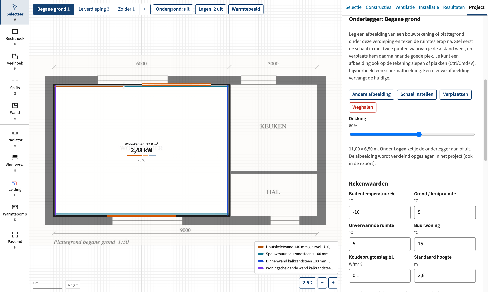
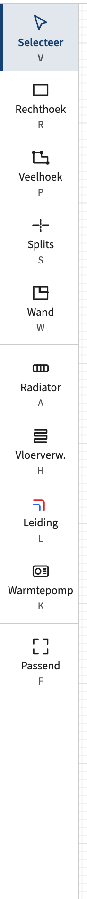
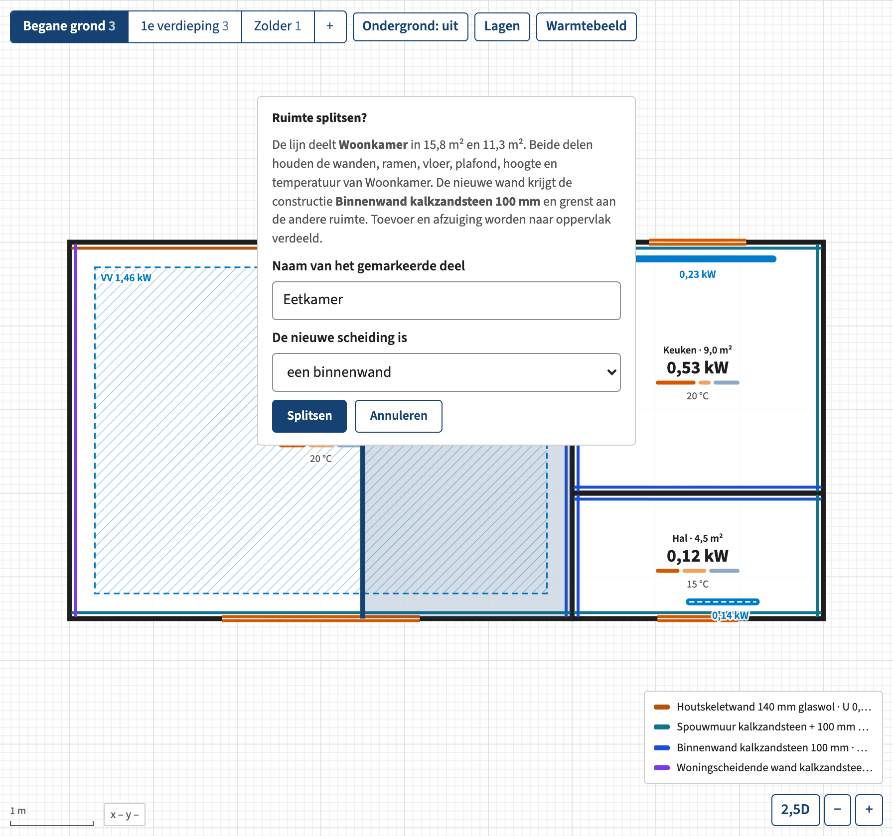
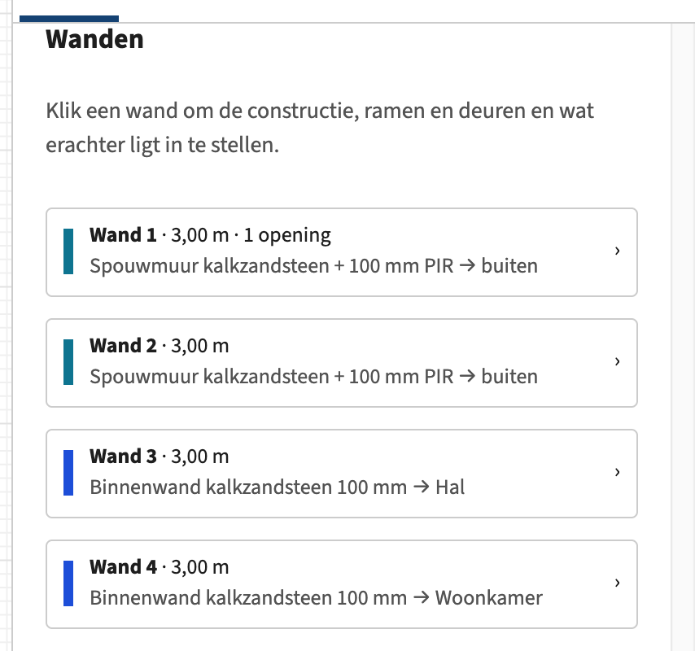
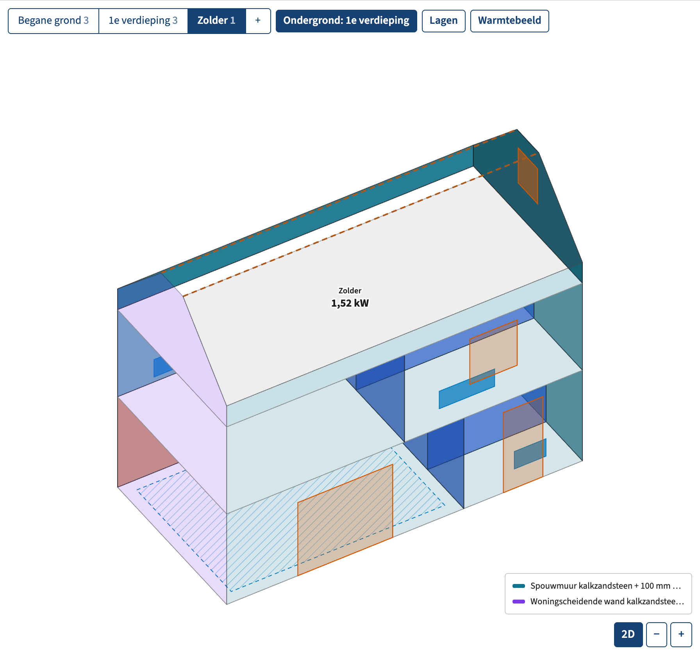
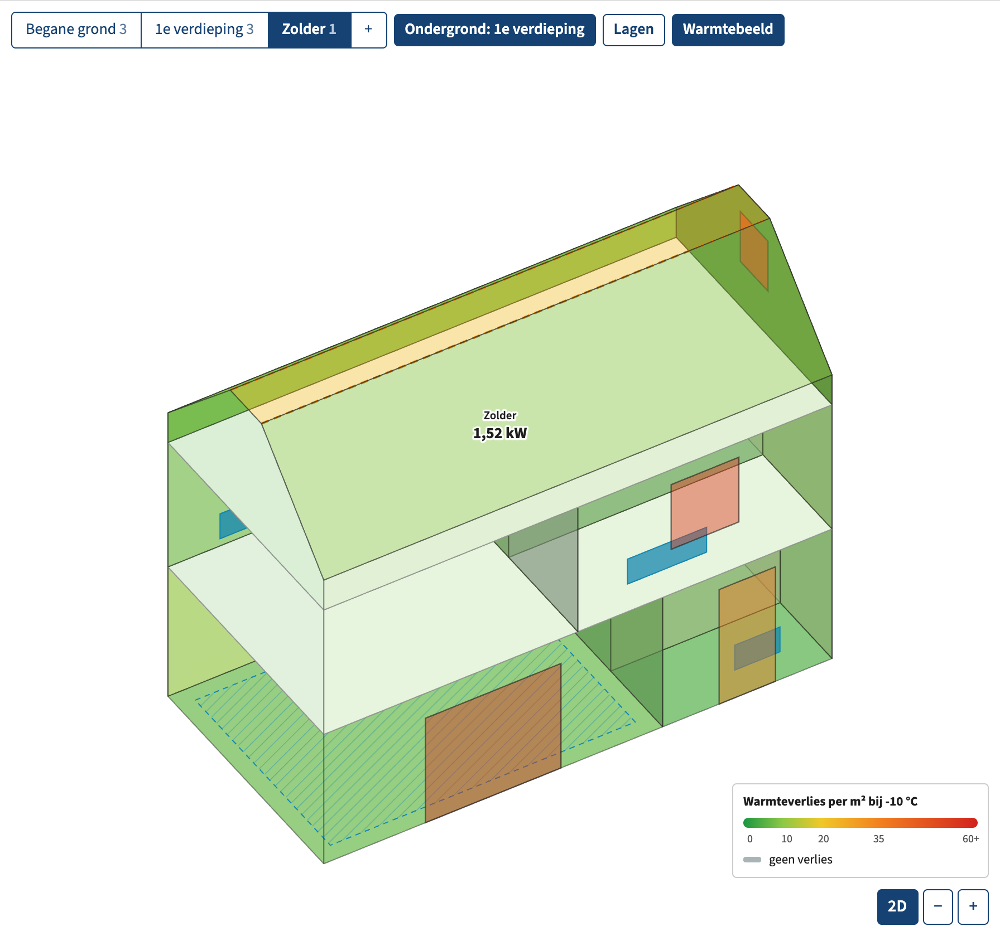

[← Overzicht](../README.md) · Vorige: [Aan de slag](gebruik.md) · Volgende: [Wat grenst waaraan](grenzen.md)

# Ruimtes en wanden tekenen

## Onderlegger: een bouwtekening overtekenen

Onder **Project → Onderlegger** leg je een afbeelding (jpg, png of webp) onder de verdieping die je open hebt, bijvoorbeeld een scan of foto van de bouwtekening. Een pdf sla je eerst op als afbeelding of je maakt er een schermafbeelding van.

1. Kies **Afbeelding kiezen**, sleep een afbeelding op de tekening of plak er een met Ctrl/Cmd+V (bijvoorbeeld een schermafbeelding van een pdf). De app verkleint de afbeelding en legt hem in beeld. Een nieuwe afbeelding vervangt de huidige; met **Andere afbeelding** kies je er een uit je bestanden.
2. Meteen daarna stel je de **schaal** in: klik twee punten waarvan je de afstand weet, bijvoorbeeld de uiteinden van een maatlijn of een gevel, en vul de werkelijke afstand in meters in. Ligt de scan scheef, kies dan een lijn die in werkelijkheid horizontaal of verticaal is, zoals een gevel. De app ziet hoeveel graden hij scheef staat en legt de tekening met het vinkje **tekening recht leggen** meteen recht. Fijnafstellen kan daarna met **Draaiing** in het paneel.
3. Met **Verplaatsen** sleep je de afbeelding naar de goede plek. Esc of *Klaar* stopt.
4. Met **Dekking** maak je hem lichter of donkerder. Onder **Lagen** zet je hem aan of uit.

Daarna teken je de ruimtes er gewoon overheen. Elke verdieping kan een eigen onderlegger hebben. De afbeelding wordt verkleind opgeslagen in het project en gaat mee in de export. Houd ze klein: de opslag in de browser is beperkt (een paar MB voor alle projecten samen). Is die vol, dan meldt de app dat.

## Wanden intekenen

Je tekent geen losse muren, maar **ruimtes**. Elke zijde van een ruimte is een wand.

1. Kies **Rechthoek** (`R`) en sleep een ruimte, of kies **Veelhoek** (`P`) en klik de hoekpunten. Sluit een veelhoek door op het eerste punt te klikken, te dubbelklikken of op Enter te drukken.
2. Punten klikken vast op het raster (standaard 5 cm, in te stellen onder **Project → Tekenen**) en op hoeken van andere ruimtes. Houd Alt ingedrukt om niet vast te klikken.
3. Met **Selecteer** (`V`) sleep je hoekpunten of een hele ruimte. Dubbelklik op een wand om er een hoekpunt bij te zetten.
4. Klik een ruimte aan en vul in het paneel de naam, ontwerptemperatuur en hoogte in.

### Eerst de omtrek, dan de binnenwanden

Je kunt ook eerst de hele verdieping als één vlak tekenen en dat daarna opdelen:

1. Teken de buitenomtrek met **Rechthoek** of **Veelhoek** en stel de buitenwanden, ramen, vloer en plafond in.
2. Kies **Wand** (`W`). Klik op de rand van de ruimte waar de binnenwand begint. Zet eventueel knikpunten binnen de ruimte voor een wand met een hoek, en klik op de rand waar hij eindigt.
3. Er verschijnt een venster *Ruimte splitsen?*. Het deel dat een nieuwe ruimte wordt, is gemarkeerd. Geef het een naam en kies **Splitsen** (of Enter). Met Esc of **Annuleren** gebeurt er niets.

Beide delen nemen over wat al bij de oorspronkelijke ruimte was ingesteld:

- De **buitenwanden** houden per stuk hun constructie, wat erachter ligt en hun splitsingen. Ramen en deuren gaan mee met het langste deel van het wanddeel waarin ze zaten.
- Temperatuur, hoogte, vloer, plafond en dak blijven gelijk.
- Toevoer en afzuiging worden naar oppervlak verdeeld. Radiatoren en vloerverwarming gaan mee met het deel waarin hun midden ligt.
- De **nieuwe wand** krijgt de eerste wandconstructie die *aan beide kanten binnen* is, en staat op *Automatisch*. Hij grenst dus aan de andere ruimte.

De twee delen delen dezelfde lijn, net als bij hart-op-hart tekenen. Ongedaan maken kan met Ctrl+Z.

## Binnenmaat of buitenmaat?

De muurdikte wordt niet getekend. De getekende lijn is de rand van de ruimte zelf:

- wandoppervlak = lengte van de lijn × hoogte, min ramen en deuren;
- vloer- en plafondoppervlak = het oppervlak binnen de lijnen;
- luchtvolume = vloeroppervlak × hoogte.

Teken daarom **op binnenmaat**, of hart-op-hart als je snel wilt werken. Dat laatste geeft iets te grote oppervlakken. Op binnenmaat mis je aan de buitenkant wat oppervlak bij de hoeken. Daar is de koudebrugtoeslag ΔU voor (standaard +0,1 W/m²K op de buitenschil). Buitenmaat raden we af: dan tel je de muurdikte mee in vloer, plafond en volume, en valt het verlies te hoog uit.

Op binnenmaat zit tussen twee ruimtes een gat ter dikte van de binnenwand. De app ziet twee evenwijdige wanden toch als één gedeelde wand zolang ze minder dan **Max. wanddikte aangrenzing** uit elkaar liggen (standaard 0,35 m, onder **Project → Tekenen**). Is een tussenmuur dikker, bijvoorbeeld een oude dragende muur, zet die waarde dan hoger.

## Uit welke wanden bestaat een ruimte?

Klik een ruimte aan. Onder **Wanden** staat dan elk wanddeel met zijn lengte, constructie en wat erachter ligt. Ga je met de muis over een regel, dan licht die wand op in de tekening. Klik je erop, dan bewerk je dat wanddeel. Dat werkt hetzelfde als wanneer je de wand in de tekening aanklikt.

## Wand splitsen

Bestaat een wand uit verschillende delen, bijvoorbeeld een stuk buitenmuur en een stuk binnenwand, of een geïsoleerd en een ongeïsoleerd deel? Gebruik dan **Splits** (`S`) en klik op de plek waar de wand verandert. Je kunt de splitsing ook op een exacte afstand vanaf de hoek invullen. Elk deel krijgt een eigen constructie en een eigen **Grenst aan**.

## Ramen en deuren

Klik het wanddeel aan en kies **+ Raam of deur**. Vul de breedte, hoogte en constructie in. Het oppervlak gaat automatisch van de wand af.

Een nieuw raam staat in het midden van het wanddeel. Wil je het verplaatsen, sleep het dan in de plattegrond over de muur. Tijdens het slepen zie je de afstand tot beide uiteinden. Je kunt de plek ook precies invullen bij **Begint op** (in meter vanaf de hoek waar de wand begint). Een raam of deur blijft binnen zijn eigen wanddeel. Met **Onderkant** geef je aan hoe hoog het raam boven de vloer begint. Standaard staat een deur (vanaf 1,9 m hoog) op de vloer en begint een raam op 0,9 m. Voor de berekening maken de plek en de hoogte niet uit, maar in de tekening en de 2,5D-weergave staat het raam dan wel goed. Komt het raam boven de wand uit, dan waarschuwt de app.

**Binnendeuren**: een deur in een wand tussen twee ruimtes rekent met de temperatuur van de ruimte erachter, niet met buiten. Zet je een opening in een gedeeld wanddeel, dan wordt het automatisch een *Binnendeur, niet geïsoleerd* (U ≈ 2,2 W/m²K, indicatief), en die verschijnt in beide ruimtes. Bestaande projecten krijgen die constructie er één keer bij.

Vul bij breedte en hoogte de **buitenmaat van het kozijn** in (het gat in de muur), niet de dagmaat. Gebruik daarbij de **Uw** van het hele raam, dus glas en kozijn samen, en niet de Ug van alleen het glas.

## 2,5D-weergave

Met de knop **2,5D** rechtsonder, of de toets `D`, zie je de woning schuin van boven. De verdiepingen tot en met de gekozen verdieping staan op elkaar. Wanden hebben de kleur van hun constructie, en ramen en deuren zijn oranje. Om te draaien en te kantelen sleep je met ingedrukt scrollwiel, of met Shift + slepen. De weergave draait dan om het punt waar je begon met slepen. Gewoon slepen schuift, en scrollen zoomt rond de muis. Klik een vloer of wand aan om hem in het paneel te bewerken. Tekenen doe je in de plattegrond: kies je een tekengereedschap, dan schakelt de app daar vanzelf naar terug.

## Warmtebeeld: waar verlies je de meeste warmte?

Met de knop **Warmtebeeld** boven de tekening kleurt elk vlak naar zijn warmteverlies per m² bij de ontwerptemperatuur: groen is weinig, rood is veel. Zo zie je in één oogopslag waar je het meeste verliest, bijvoorbeeld een slecht geïsoleerd dak of enkel glas. Het werkt in de plattegrond (wanden en ramen) en in de 2,5D-weergave (ook vloeren, daken en plafonds naar buiten of een onverwarmde ruimte). Grijs betekent geen verlies, bijvoorbeeld een wand tussen twee ruimtes van dezelfde temperatuur. Het verlies per m² is (U + ΔU) × het temperatuurverschil, dus een wand naar de buren (15 °C) kleurt groener dan dezelfde wand naar buiten. Nog een keer klikken zet de gewone kleuren per constructie terug.

---

[← Overzicht](../README.md) · Vorige: [Aan de slag](gebruik.md) · Volgende: [Wat grenst waaraan](grenzen.md)
