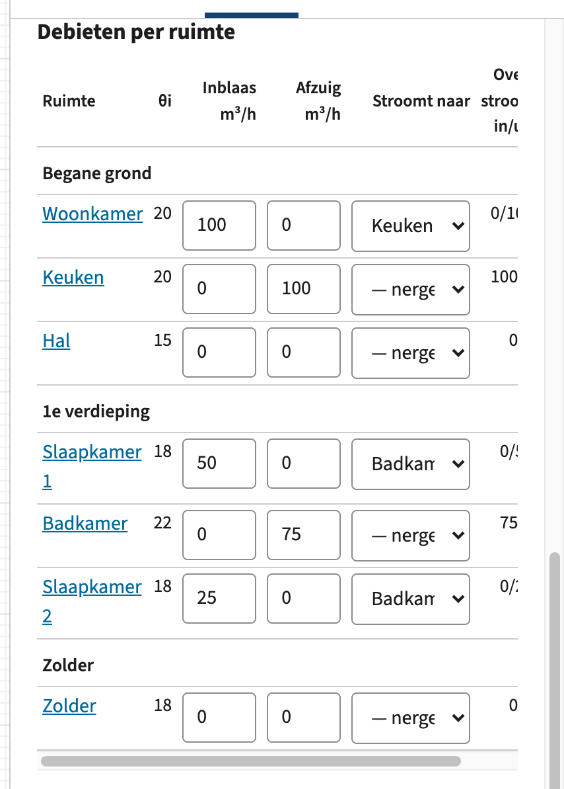
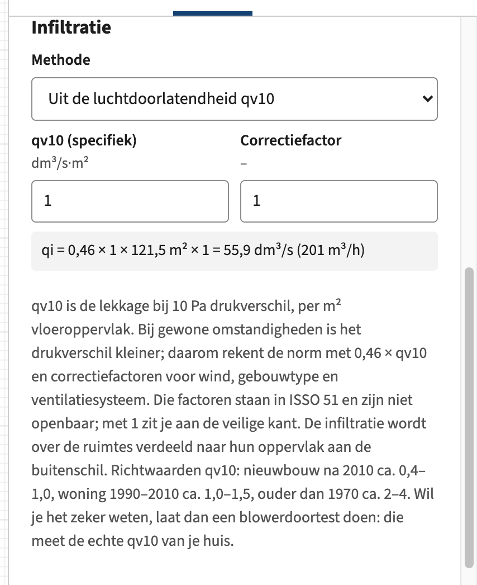

[← Overzicht](../README.md) · Vorige: [Constructies en isolatiewaarde](constructies.md) · Volgende: [Radiatoren, convectoren en vloerverwarming](afgifte.md)

# Ventilatie en infiltratie

Onder **Ventilatie** kies je het systeem (A, C of D met WTW) en vul je per ruimte de inblaas of toevoer en de afzuiging in m³/h in.

Per ruimte geef je bij **Lucht stroomt over naar** aan waar de lucht heen gaat: via een spleet onder de deur, een overstroomrooster of een open verbinding. Bijvoorbeeld slaapkamer → overloop → badkamer. Je kiest dat bij de ruimte zelf, of in de tabel onder Ventilatie. Hoeveel lucht het is, rekent de app zelf uit: wat er na de afzuiging in die ruimte overblijft, plus wat er uit andere ruimtes binnenkomt. Zo telt een keten vanzelf op. De ontvangende ruimte rekent met de temperatuur van de ruimte waar de lucht vandaan komt.

In het tabblad Ventilatie laat de plattegrond de luchtstromen zien als bewegende pijlen met m³/h, en per ruimte de inblaas en afzuiging. Selecteer je een ruimte, dan zie je de stromen van en naar die ruimte. Stroomt lucht naar een andere verdieping, dan staat dat bij de ruimte (↑ naar Overloop 50 m³/h).

Gaat lucht uit één ruimte naar meer dan één andere ruimte, vul dan de vaste aftakking in bij **Handmatige overstroom (geavanceerd)**, bijvoorbeeld hal → toilet 20 m³/h. Kies daarnaast bij *Stroomt naar* de ruimte die de rest krijgt, bijvoorbeeld hal → woonkamer. Die rest rekent de app automatisch uit. Blijft er in een ruimte lucht over die nergens heen gaat, dan staat bij die ruimte hoeveel er binnenkomt en hoeveel eruit gaat.

## Infiltratie

Onder **Ventilatie → Infiltratie** reken je de luchtlekkage van de woning uit met de **qv10**: de lekkage bij 10 Pa drukverschil, in dm³/s per m² vloeroppervlak. De app rekent met 0,46 × qv10 × vloeroppervlak × correctiefactor, en verdeelt dat over de ruimtes naar hun oppervlak aan de buitenschil. Ken je de qv10 van je huis niet, gebruik dan de richtwaarden bij het veld. Wil je het zeker weten, laat dan een blowerdoortest doen: die meet de echte qv10.

---

[← Overzicht](../README.md) · Vorige: [Constructies en isolatiewaarde](constructies.md) · Volgende: [Radiatoren, convectoren en vloerverwarming](afgifte.md)
